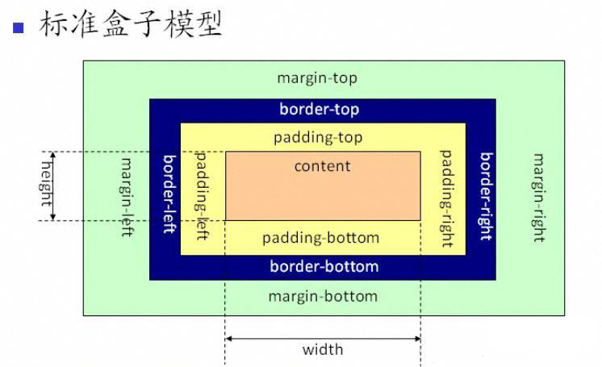
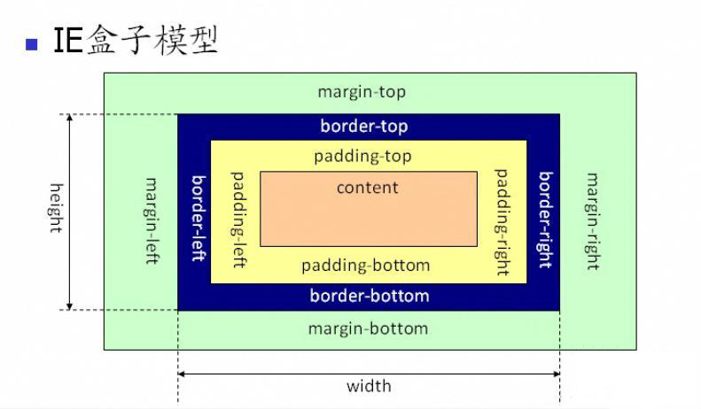
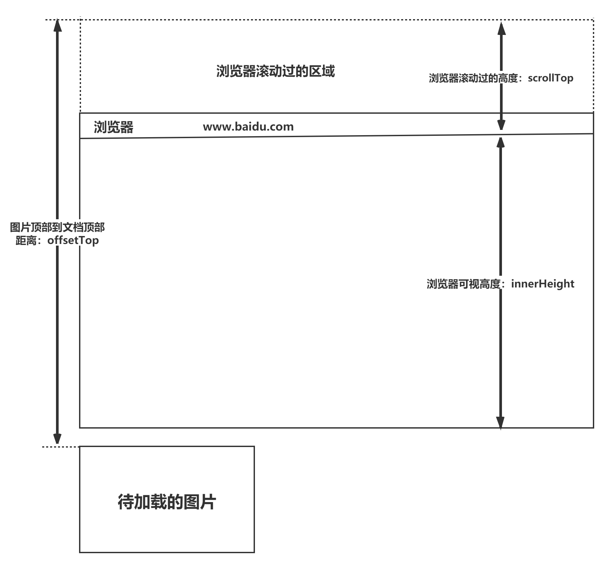

# CSS 基础

## 1. CSS 选择器及其优先级

> 优先级权重的数字仅做大小比较以简化记忆，不能进位，叠加

| **选择器** | **格式** | **优先级权重** |
| :---: | :---: | :---: |
| id 选择器 | `#id` | 100 |
| 类选择器 | `.classname` | 10 |
| 属性选择器 | `a[ref="eee"]` | 10 |
| 伪类选择器 | `li:last-child` | 10 |
| 标签选择器 | `div` | 1 |
| 伪元素选择器 | `li::after` | 1 |
| 相邻同胞选择器 | `h1 + p`（选中与 `h1` 有同一个父元素且紧跟 `h1` 之后的 `p`） | 0 |
| 子选择器 | `ul > li` | 0 |
| 后代选择器 | `li a` | 0 |
| 通配符选择器 | `*` | 0 |

对于选择器的**优先级**：

* 标签选择器、伪元素选择器：1；
* 类选择器、伪类选择器、属性选择器：10；
* id 选择器：100；
* 内联样式：1000；

**内联样式 > `id` 选择器 > 类、属性、伪类选择器 > 标签、伪元素选择器**

**注意事项：**

- `!important` 声明的样式优先级最高；
* 如果优先级相同，则最后出现的样式生效；
* 继承得到的样式的优先级最低；
- 通用选择器（`*`）、子选择器（`>`）和相邻同胞选择器（`+`）并不在这四个等级中，所以它们的**权值都为 0**；
- 样式表来源不同时，优先级顺序为：内联样式 > 内部样式、外部样式（两者平级，后解析覆盖先解析）> 浏览器用户自定义样式 > 浏览器默认样式。

## 2. `display` 的属性值及其作用

| **属性值** | **作用** |
| :---: | :---: |
| `none` | 元素不显示，并且会从文档流中移除。 |
| `block` | 块类型。默认宽度为父元素宽度，可设置宽高，换行显示。 |
| `inline` | 行内元素类型。默认宽度为内容宽度，不可设置宽高，同行显示。 |
| `inline-block` | 默认宽度为内容宽度，可以设置宽高，同行显示。 |
| `list-item` | 像块类型元素一样显示，并添加样式列表标记。 |
| `table` | 此元素会作为块级表格来显示。 |
| `inherit` | 规定应该从父元素继承 `display` 属性的值。 |

## 3. `display` 的 `block`、`inline` 和 `inline-block` 的区别

（1）**`block`：**会独占一行，多个元素会另起一行，可以设置 `width`、`height`、`margin` 和 `padding` 属性；

（2）**`inline`：**元素不会独占一行，设置 `width`、`height` 属性无效。但可以设置水平方向的 `margin` 和 `padding` 属性，不能设置垂直方向的 `padding` 和 `margin`（虽然可以设置垂直方向的 `padding`，但不会影响布局）；

（3）**`inline-block`：**将对象设置为 `inline` 对象，但对象的内容作为 `block` 对象呈现，之后的内联对象会被排列在同一行内。

对于行内元素和块级元素，其特点如下：

**（1）行内元素**

* 设置宽高无效；
- 可以设置水平方向的 `margin` 和 `padding` 属性，不能设置垂直方向的 `padding` 和 `margin`；
* 不会自动换行；

**（2）块级元素**

* 可以设置宽高；
- 设置 `margin` 和 `padding` 都有效；
* 可以自动换行；
* 多个块状，默认排列从上到下。

## 4. 隐藏元素的方法有哪些

- **`display: none`**：渲染树不会包含该渲染对象，因此该元素不会在页面中占据位置，也不会响应绑定的监听事件。
- **`visibility: hidden`**：元素在页面中仍占据空间，但是不会响应绑定的监听事件。
- **`opacity: 0`**：将元素的透明度设置为 0，以此来实现元素的隐藏。元素仍占据空间，并且能够响应绑定的监听事件。
- **`position: absolute`**：通过绝对定位将元素移出可视区域，以此来实现隐藏。
- **`z-index` 为负值**：使其他元素遮盖该元素，以此来实现隐藏。
- **`clip`/`clip-path`**：使用元素裁剪实现隐藏；元素仍占据空间，但是不会响应绑定的监听事件。
- **`transform: scale(0, 0)`**：将元素缩放为 0；元素仍占据空间，但是不会响应绑定的监听事件。

## 5. `display: none` 与 `visibility: hidden` 的区别

这两个属性都是让元素隐藏，不可见。**两者区别如下：**

（1）**在渲染树中**

- `display: none` 会让元素完全**从渲染树中消失**，渲染时不会占据任何空间；
- `visibility: hidden` **不会让元素从渲染树中消失**，渲染的元素还会占据相应的空间，只是内容不可见。

（2）是否是**继承属性**

- `display: none` 是非继承属性，**子孙节点会随着父节点从渲染树消失**，通过修改子孙节点的属性也无法显示；
- `visibility: hidden` 是继承属性，子孙节点消失是由于继承了 `hidden`，通过设置 `visibility: visible` 可以让子孙节点显示；

（3）修改常规文档流中元素的 `display` 通常会造成文档的重排，但是修改 `visibility` 属性只会造成本元素的重绘；

（4）如果使用读屏器，设置为 `display: none` 的内容不会被读取，设置为 `visibility: hidden` 的内容会被读取。

## 6. 伪元素和伪类的区别和作用？

- 伪元素：在内容元素的前后插入**额外的元素或样式**，但这些元素实际上并不在文档中生成。它们只在外部显示可见，不会在文档源代码中找到，例如：

```css
p::before {content:"第一章：";}
p::after {content:"Hot!";}
p::first-line {background:red;}
p::first-letter {font-size:30px;}
```

- 伪类：将**特殊的效果**添加到特定选择器上。它是在已有元素上添加类别，不会产生新的元素，例如：

```css
a:hover {color: #FF00FF}
p:first-child {color: red}
```

**总结：**伪类通过在元素选择器上加入伪类改变元素状态，而伪元素通过对元素的操作改变元素呈现。

## 7. 对 `requestAnimationFrame` 的理解

HTML5 提供了一个专门用于请求动画的 API：`requestAnimationFrame`，顾名思义就是**请求动画帧**。

MDN对该方法的描述：

> window.requestAnimationFrame() 告诉浏览器——你希望执行一个动画，并且要求浏览器在下次重绘之前调用指定的回调函数更新动画。该方法需要传入一个回调函数作为参数，该回调函数会在浏览器下一次重绘之前执行。

**语法：**`window.requestAnimationFrame(callback)`。该回调函数会被传入 `DOMHighResTimeStamp` 参数，它表示 `requestAnimationFrame()` 开始执行回调函数的时刻。

**取消动画：**使用 `cancelAnimationFrame()` 取消动画。该方法接收一个参数，即 `requestAnimationFrame()` 默认返回的 ID。

**优势：**

- **CPU 节能**：使用 `setInterval` 实现的动画在页面被隐藏或最小化时仍会在后台执行，浪费 CPU 资源。而 `requestAnimationFrame` 会随系统暂停屏幕刷新任务，页面重新激活时再继续执行，有效节省 CPU 开销。
- **函数节流**：在高频率的 `resize`、`scroll` 等事件中，`requestAnimationFrame` 可保证每个刷新间隔内函数只执行一次，兼顾流畅性和性能。
- **减少回流/重排**：`requestAnimationFrame` 会把每一帧中的 DOM 操作集中起来，在一次重绘或回流中完成。

## 8. 对盒模型的理解

CSS3 中的盒模型有两种：标准盒模型和 IE 盒模型。





盒模型都由四个部分组成，分别是 `margin`、`border`、`padding` 和 `content`。

标准盒模型和 IE 盒模型的区别在于设置 `width` 和 `height` 时，所对应的范围不同：

- 标准盒模型的 `width` 和 `height` 属性范围只包含 `content`；
- IE 盒模型的 `width` 和 `height` 属性范围包含 `border`、`padding` 和 `content`。

可以通过修改元素的 `box-sizing` 属性来改变元素的盒模型：

- `box-sizing: content-box` 表示标准盒模型（默认值）。
- `box-sizing: border-box` 表示 IE 盒模型（怪异盒模型）。


## 9. CSS3 中有哪些新特性

* 新增各种 CSS 选择器（`:not(.input)`：所有 `class` 不是 `input` 的节点）

  结构伪类：
  `:nth-child(n)`：第 n 个子元素
  `:nth-child(2n)`：选择偶数序号的子元素
  否定伪类：

  `:not(.input)`：所有 `class` 不是 `input` 的节点

* 圆角（`border-radius: 8px`）

  ```css
  border-radius:50%;
  /*正圆形*/
  ```

  

* 多列布局 （multi-column layout）

  ```css
  column-count:3;
  column-gap:20px;
  column-rule: 1px solid #ccc;
  /*分为三列,间隔20px,分割线隔开*/
  ```

  纯CSS实现瀑布流布局

  ```css
  /* 父容器 */
  .waterfall {
    column-count: 3; /* 几列 */
    column-gap: 16px; /* 列间距 */
  }
  
  /* 子卡片 */
  .card {
    break-inside: avoid; /* 不被切断 */
  }
  ```

  

* 阴影（`box-shadow`）

* 文字特效（`text-shadow`）

* 文字渲染（`text-decoration`）：CSS3 中不仅可以添加下划线 `underline`/删除线 `line-through`，还可以控制线的形状和颜色。

  ```css
  text-decoration: underline wavy red;
  /*下划线,波浪线,红色*/
  ```

* 渐变（`gradient`）
  分为线性渐变（`linear-gradient`，例如从上到下颜色过渡）和径向渐变（`radial-gradient`，从中心向四周发散）。

* `transform`：在不影响页面其他元素布局的情况下，对元素进行空间变换：
  `translate(x,y)` 平移

  ```css
  position:absolute;
  top:50%;
  left:50%;
  transform:translate(-50%,-50%);
  /*实现绝对居中*/
  ```

  `scale(x,y)`缩放大小
  `rotate(deg)`旋转角度
  `skew(deg,deg)`倾斜拉伸

* 多背景：
   CSS3 允许给同一个元素添加多层背景图，用逗号分隔即可：
  `background: url(bg1.png), url(bg2.png);`，前面的图层会盖在后面的图层上。

* `animation` 关键帧动画

## 10. 单行、多行文本溢出隐藏

**文本溢出：**容器内的**文本内容超过了容器本身设定的宽度/高度（块级或行内块元素）**。默认情况下，CSS 的处理方式为“溢出显示”。

* 单行文本溢出（表格，导航栏欢迎用户xxx...）

```css
overflow: hidden;            // 溢出隐藏
text-overflow: ellipsis;      // 溢出用省略号显示
white-space: nowrap;         // 规定段落中的文本不进行换行
```

* 多行文本溢出（文章摘要，用户评论...）

```css
overflow: hidden;            // 溢出隐藏
text-overflow: ellipsis;     // 溢出用省略号显示
display:-webkit-box;         // 作为弹性伸缩盒子模型显示。
-webkit-box-orient:vertical; // 设置伸缩盒子的子元素排列方式：（每行）从上到下垂直排列
-webkit-line-clamp:3;        // 显示的行数
```

`-webkit-box` 是 `flex` 弹性盒子的旧版，目前只用于多行文本截断。

## 11. 对媒体查询的理解？

媒体查询由一个可选的媒体类型和零个或多个限制媒体功能的表达式组成，例如宽度、高度和颜色。
媒体查询，添加自CSS3，允许内容的呈现针对⼀个特定范围的输出设备而进行裁剪，而不必改变内容本身，适合web网页应对不同型号的设备而做出对应的响应适配。

媒体查询包含一个可选的媒体类型和满足CSS3规范的条件下，包含零个或多个表达式，这些表达式描述了媒体特征，最终会被解析为true或false。如果媒体查询中指定的媒体类型匹配展示⽂档所使⽤的设备类型，并且**所有的表达式的值都是true**，那么该媒体查询的结果为true。那么媒体查询内的样式将会⽣效。

```html
<!-- link 元素中的 CSS 媒体查询 -->
<link rel="stylesheet" media="(max-width: 800px)" href="example.css" /> 
<!-- 样式表中的 CSS 媒体查询 -->
<style> 
@media (max-width: 600px) { 
  .facet_sidebar { 
    display: none; 
  } 
}
</style>
```

简单来说，使用 `@media` 查询可以针对不同的媒体类型和屏幕尺寸定义不同的样式。调整浏览器大小时，页面也会根据浏览器的宽度和高度重新渲染。

## 12. 如何判断元素是否到达可视区域

- 内容达到显示区域的条件：`img.offsetTop < window.innerHeight + window.scrollY;`



**问题：**这套计算逻辑绑定在浏览器的 `scroll` 事件上。而滚动事件触发得极度频繁，不断读取 `offsetTop` 等属性会触发浏览器反复计算布局，导致页面卡顿。

现代解决方案：现代浏览器提供了 `IntersectionObserver` 的 API。

### 图片懒加载

```html
<!-- src 里放一个极小的占位图，甚至不写 src；data-src 里藏着真正的图片地址 -->

```

```js
// 1. 定义回调函数：当目标元素和视口发生“交叉”变化时触发
const callback = (entries, observer) => {
  entries.forEach(entry => {
    // entry.isIntersecting 是一个布尔值，为 true 表示元素进入了视口
    if (entry.isIntersecting) {
      const img = entry.target;
      img.src = img.dataset.src; // 替换真实的图片地址（懒加载逻辑）
      
      // 重点：图片加载后，取消观察，节省内存
      observer.unobserve(img); 
    }
  });
};

// 2. 创建观察者实例
const observer = new IntersectionObserver(callback, {
  root: null, // 默认是视口 (viewport)
  rootMargin: '100px', // 可以在视口外围增加一个“缓冲带”，比如提前 100px 加载
  threshold: 0.1 // 交叉比例，0.1 表示元素有 10% 进入视口就触发回调
});

// 3. 选中所有需要懒加载的图片，开始观察
const imgs = document.querySelectorAll('.lazy-load-img');
imgs.forEach(img => observer.observe(img));
```


## 13. CSS的回流（重排）,重绘

**回流（重排）：**当**元素的尺寸、位置或结构**发生改变时，浏览器需要重新计算页面元素的几何属性，并重新排列它们的位置。该操作代价较高，可能导致整个页面或部分页面重新布局。

**重绘：**当元素的**外观样式**发生改变，但没有改变几何尺寸和位置时，浏览器只需应用新的样式，代价相对较低。

重排必定引起重绘，但重绘不一定引发重排。
