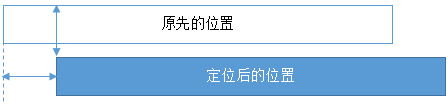
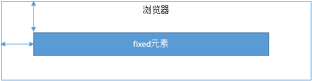
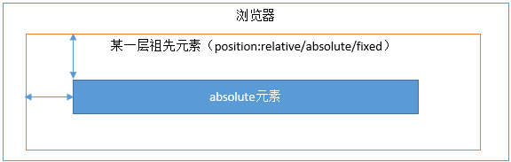
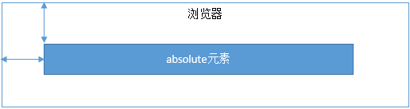

# CSS 定位与浮动

## 1. 为什么需要清除浮动？清除浮动的方式

**浮动的定义：**在非 IE 浏览器下，容器不设高度且子元素浮动时，容器高度不能被内容撑开。此时内容会溢出到容器外面而影响布局，这种现象通常称为高度塌陷。

**浮动的工作原理：**

* 浮动元素脱离文档流，不占据空间（引起“高度塌陷”现象）
* 浮动元素碰到包含它的边框或者其他浮动元素的边框停留

浮动元素可以左右移动，直到遇到另一个浮动元素或者遇到它外边缘的包含框。浮动框不属于文档流中的普通流，当元素浮动之后，不会影响块级元素的布局，只会影响内联元素布局。此时文档流中的普通流就会表现得该浮动框不存在一样的布局模式。当包含框的高度小于浮动框的时候，此时就会出现“高度塌陷”。

**浮动元素引起的问题？**

* 父元素的高度无法被撑开，影响与父元素同级的元素
* 与浮动元素同级的非浮动元素会跟随其后
* 若浮动的元素不是第一个元素，则该元素之前的元素也要浮动，否则会影响页面的显示结构

**清除浮动的方式如下：**

- 给父级 `div` 定义 `height` 属性；
- 在最后一个浮动元素之后添加空的 `div` 标签，并添加 `clear: both` 样式；
- 给包含浮动元素的父级标签添加 `overflow: hidden` 或 `overflow: auto`；
- 使用 `::after` 伪元素。

```css
.clearfix:after{
    content: "";
    display: table; 
    clear: both;
  }
```

## 2. 对 BFC 的理解，如何创建 BFC

先来看两个相关的概念：

- **Box**：Box 是 CSS 布局的对象和基本单位，一个页面由很多个 Box 组成，这个 Box 就是我们所说的盒模型。
- **Formatting context**：块级格式化上下文，是页面中的一块渲染区域，并且有一套渲染规则，决定其子元素如何定位，以及与其他元素的关系和相互作用。

块格式化上下文（Block Formatting Context，BFC）是 Web 页面的可视化 CSS 渲染的一部分，是布局过程中生成块级盒子的区域，也是浮动元素与其他元素的交互限定区域。

通俗来讲：BFC是一个独立的布局环境，可以理解为一个容器，在这个容器中按照一定规则进行物品摆放，并且不会影响其它环境中的物品。如果一个元素符合触发BFC的条件，则BFC中的元素布局不受外部影响。

**创建 BFC 的条件：**

- 根元素：`body`；
- 元素设置浮动：`float` 除 `none` 以外的值；
- 元素设置绝对定位：`position: absolute` 或 `fixed`；
- `display` 值为：`inline-block`、`table-cell`、`table-caption` 等；
- `overflow` 值为：`hidden`、`auto`、`scroll`；

**BFC 的特点：**

* 垂直方向上，自上而下排列，和文档流的排列方式一致。
- 在 BFC 中上下相邻的两个容器的 `margin` 会重叠；
- 计算 BFC 的高度时，需要计算浮动元素的高度；
- BFC 区域不会与浮动容器发生重叠；
- BFC 是独立的容器，容器内部元素不会影响外部元素；
- 每个元素的左 `margin` 会和容器的左 `border` 相接触。

**BFC 的作用：**

- **解决 `margin` 重叠问题**：BFC 是独立区域，内部元素和外部元素互不影响，将两个元素变为两个 BFC 即可解决 `margin` 重叠。
- **解决高度塌陷问题**：子元素浮动后，父元素可能发生高度塌陷。只需将父元素变成 BFC，常用方法是设置 `overflow: hidden`。
- **创建自适应两栏布局**：左边宽度固定，右边宽度自适应。

```css
.left{
     width: 100px;
     height: 200px;
     background: red;
     float: left;
 }
 .right{
     height: 300px;
     background: blue;
     overflow: hidden;
 }
```

```html
<div class="left"></div>
<div class="right"></div>
```

左侧设置 `float: left`，右侧设置 `overflow: hidden`。这样右侧就触发了 BFC，BFC 区域不会与浮动元素发生重叠，从而实现自适应两栏布局。

## 3. 什么是 `margin` 重叠问题？如何解决？

**问题描述：**

两个块级元素的上外边距和下外边距可能会合并（折叠）为一个外边距，其大小会取其中外边距值大的那个，这种行为就是外边距折叠。需要注意的是，**浮动的元素和绝对定位**这种脱离文档流的元素的外边距不会折叠。重叠只会出现在**垂直方向**。

**计算原则：**

折叠合并后外边距的计算原则如下：

* 如果两者都是正数，那么就去最大者
* 如果是一正一负，就会正值减去负值的绝对值
* 两个都是负值时，用0减去两个中绝对值大的那个

**解决办法：**

对于折叠的情况，主要有两种：**兄弟之间重叠**和**父子之间重叠**

（1）兄弟之间重叠

* 底部元素变为行内盒子：`display: inline-block`
- 底部元素设置浮动：`float`
- 底部元素的 `position` 值为 `absolute`/`fixed`

（2）父子之间重叠

- 父元素加入：`overflow: hidden`
- 父元素添加透明边框：`border: 1px solid transparent`
* 子元素变为行内盒子：`display: inline-block`
* 子元素加入浮动属性或定位。

## 4. `position` 的属性有哪些，区别是什么

`position` 有以下属性值：

| 属性值 | 概述 |
| :---: | --- |
| `absolute` | 生成绝对定位的元素，相对于 `static` 定位以外的一个父元素进行定位。元素的位置通过 `left`、`top`、`right`、`bottom` 属性规定。 |
| `relative` | 生成相对定位的元素，相对于其原来的位置进行定位。元素的位置通过 `left`、`top`、`right`、`bottom` 属性规定。 |
| `fixed` | 生成绝对定位的元素，相对于屏幕视口（viewport）定位。元素的位置在屏幕滚动时不会改变，例如回到顶部按钮一般使用此定位方式。 |
| `static` | 默认值，没有定位，元素出现在正常文档流中，会忽略 `top`、`bottom`、`left`、`right` 或 `z-index` 声明。 |
| `inherit` | 规定从父元素继承 `position` 属性的值。 |

前面三者的定位方式如下：

- **`relative`：**元素的定位永远相对于元素自身位置，和其他元素无关，也不会影响其他元素。



- **`fixed`：**元素的定位一般相对于浏览器视口，会让元素完全脱离正常文档流。



- **`absolute`：**会使元素完全脱离文档流。如果为 `absolute` 设置了 `top`、`left`，浏览器会以**最近的、非 `static` 定位的祖先元素**，或者**设置了 `transform`/`filter` 等属性的祖先元素**为基准定位；如果没找到，则以整个 HTML 文档的根部定位。如下图所示：





## 5. `display`、`float`、`position` 的关系

（1）首先判断 `display` 属性是否为 `none`，如果为 `none`，则 `position` 和 `float` 属性的值不影响元素最终的表现。

（2）然后判断 `position` 的值是否为 `absolute` 或 `fixed`。如果是，则 `float` 属性失效，并且 `display` 的值会根据初始转换值设置为 `table` 或 `block`。

（3）如果 `position` 的值不为 `absolute` 或 `fixed`，则判断 `float` 的值是否为 `none`。如果不是，则 `display` 的值按上面的规则转换。注意，如果 `position` 的值为 `relative` 且存在 `float`，则 `relative` 相对于浮动后的最终位置定位。

（4）如果 `float` 的值为 `none`，则判断元素是否为根元素。如果是根元素，`display` 属性按上面的规则转换；如果不是，则保持指定的 `display` 属性值不变。

总的来说，这类似一个优先级机制：`position: absolute` 和 `position: fixed` 优先级最高；存在它们时，浮动不起作用，`display` 的值也需要调整。其次，当元素的 `float` 值不是 `none`，或者元素是根元素时，需要调整 `display` 的值。最后，非根元素、非浮动且非绝对定位的元素，`display` 特性值与设置值相同。
