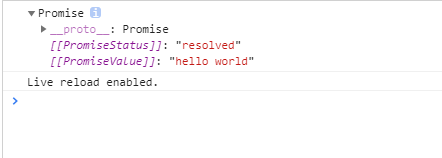

# 异步编程

WHY?

js是单线程的，同一时间只能做一件事，而有些操作很慢，会导致一个操作卡住整个程序

异步的思路是：**把“慢操作”交给别的机制去处理，主线程继续往下走，结果回来了再处理。**


## 1. 异步编程的实现方式？

JavaScript中常见的实现异步的方式可以分为以下六种：

* **回调函数 **，缺点是，多个回调函数嵌套的时候会造成回调函数地狱，上下两层的回调函数间的代码耦合度太高，不利于代码的可维护。

  > ```javascript
  > console.log('开始')
  > setTimeout(function callback() {
  >   console.log('2 秒后执行')
  > }, 2000)
  > console.log('结束')
  > //开始
  > //结束
  > //（2 秒后）2 秒后执行
  > ```

* **Promise** ，可以将嵌套的回调函数作为链式调用。但是有时会造成多个 then 的链式调用，可能会造成代码的语义不够明确。

* **Generator **，Generator 是一个可以暂停和恢复的函数，用 `function*` 定义，用 `yield` 暂停，用 `next()` 恢复。遇到异步操作时，`yield` 可以把 Promise 交出去，等 Promise 完成后再通过 `next(result)` 把结果传回来，继续执行。但 Generator 不会自己跑，需要 co 之类的自动执行器。

  > ```javascript
  > function* gen() {
  >   const user = yield getUser()
  >   console.log('拿到用户：', user.name)
  > 
  >   const orders = yield getOrders(user.id)
  >   console.log('拿到订单：', orders)
  > 
  >   const detail = yield getDetail(orders[0].id)
  >   console.log('拿到详情：', detail)
  > }
  > 
  > const g = gen()
  > // 第 1 次 next：执行到第一个 yield，拿到 getUser() 的 Promise
  > const p1 = g.next().value// getUser() 返回的 Promise
  > p1.then(user => {
  >     //// 把 user 传回去，继续执行到下一个 yield
  >   const p2 = g.next(user).value//getOrders返回的 Promise
  >   p2.then(orders => {
  >     const p3 = g.next(orders).value
  >     // getDetail返回的 Promise
  >     p3.then(detail => {
  >       // getDetail 完成，把 detail 传回去，函数执行完毕
  >       g.next(detail)
  >     })
  >   })
  > })
  > ```
  >
  > 

* **async/await 函数 **的方式，async / await 函数是 Promise 的语法糖，写法上借鉴了 Generator 的“暂停/恢复”机制，并自带执行器。
  当函数内部执行到一个 await 语句的时候，如果语句的结果是一个 promise 对象，那么函数将会等待 promise 对象的状态变为 resolve 后再继续向下执行。因此可以将异步逻辑，转化为同步的顺序来书写，并且这个函数可以自动执行。

  ---

  *不常考* :

* **事件监听** : 给某个事件绑定一个回调，事件触发时，回调被调用

* **发布订阅** : 一种消息传递模式：发布者不直接把消息发给订阅者，而是发给一个调度中心，由调度中心负责把消息分发给所有订阅了该消息的订阅者。

## 2.微任务和宏任务

```javascript
setTimeout(function callback() {
  console.log('2 秒后执行')//回调
}, 2000)//慢操作：等待2s
```

异步操作发起后，回调不会立刻执行。那它什么时候执行？由**事件循环**和**任务队列**决定

### 事件循环（Event Loop）

核心：不断检查主栈是否为空，空了就去取任务执行

一轮事件循环 = 从“取一个宏任务”到“清空它产生的所有微任务”

| 角色           | 作用         |
| :------------- | :----------- |
| 主栈（调用栈） | 执行同步代码 |
| 微任务队列     | 存放微任务   |
| 宏任务队列     | 存放宏任务   |

**执行流程：**

```
1. 执行主栈里的同步代码
2. 主栈空了
3. 清空所有微任务
4. 取一个宏任务执行
5. 宏任务执行完，再清空所有微任务
6. 再取下一个宏任务
7. 循环往复
```

**关键：微任务优先于宏任务。每执行完一个宏任务，都要先清空微任务队列。**

### 宏任务（macrotask）

**常见的宏任务：**

- `setTimeout`
- `setInterval`
- I/O 操作
- UI 渲染

**特点：**

- 每轮事件循环只取**一个**宏任务执行
- 执行完一个宏任务，会先清空微任务队列，再取下一个宏任务

### 微任务（microtask）

**常见的微任务：**

- `Promise.then` / `catch` / `finally`
- `queueMicrotask`
- `MutationObserver`
- `await` 后面的代码

**特点：**

- 主栈空了之后，**一次性清空所有微任务**
- 微任务执行过程中产生的新微任务，也会在这一轮被清空
- 微任务全部清空后，才执行下一个宏任务

## 3. setTimeout、Promise、Async/Await 的区别

|              | setTimeout            | Promise              | async/await      |
| :----------- | :-------------------- | :------------------- | :--------------- |
| 是什么       | 定时器 API            | 异步管理对象         | 语法糖           |
| 作用         | 延迟执行回调          | 管理异步结果         | 用同步写法写异步 |
| **回调放哪** | 宏任务队列            | 微任务队列           | 微任务队列       |
| 执行时机     | 主栈空 + 微任务清空后 | 主栈空后，微任务阶段 | 同 Promise       |

### （1）setTimeout

第二个参数x：延迟x毫秒进行；若为空，则把回调放入宏任务队列，等主栈空了再执行。

```javascript
console.log('script start')	//1. 打印 script start
setTimeout(function(){
    console.log('settimeout')	// 4. 打印 settimeout
})	// 2. 调用 setTimeout 函数，并定义其完成后执行的回调函数
console.log('script end')	//3. 打印 script end
// 输出顺序：script start->script end->settimeout
```

### （2）Promise

`new Promise(executor)` 时，传入的 executor 函数是同步执行的。当在 executor 中调用 resolve 或 reject 时，只是改变 Promise 的状态，then / catch 的回调不会立刻执行，而是被放入微任务队列，等主栈（同步代码）执行完后才执行。

**Promise 的状态有三种：**

- `pending`（进行中）
- `fulfilled`（成功）
- `rejected`（失败）

```javascript
console.log('script start')
let promise1 = new Promise(function (resolve) {
    console.log('promise1')
    resolve()
    console.log('promise1 end')
}).then(function () {
    console.log('promise2')
})
setTimeout(function(){
    console.log('settimeout')
})
console.log('script end')
// 输出顺序: script start->promise1->promise1 end->script end->promise2->settimeout
```

当 JS 主线程执行到 Promise 对象时：

- promise1.then() 的回调是一个微任务
- promise1 是 fulfilled 或 rejected 时：这个微任务会放入当前事件循环回合的微任务队列
- promise1 是 pending：这个微任务不会立刻入队。等将来某个时刻 Promise 状态改变了，才会入队。
- setTimeout 的回调是一个宏任务，会被放入宏任务队列，即使是 0ms 的情况

### （3）async/await

```javascript
async function async1(){
   console.log('async1 start');
    await async2();
    console.log('async1 end')
}
async function async2(){
    console.log('async2')
}

console.log('script start');
async1();
console.log('script end')
// 输出顺序：script start->async1 start->async2->script end->async1 end
```

async 函数返回一个 Promise 对象，当函数执行的时候，遇到 await 会暂停当前 async 函数的执行，把后面的代码放入微任务队列，等 await 的 Promise 完成后，再继续执行

## 4. 对Promise的理解 

Promise 对象是异步编程的一种解决方案。他的出现避免了回调地狱。Promise 是一个构造函数，接收一个函数作为参数，返回一个 Promise 实例。

一个 Promise 实例有三种状态

* Pending（进行中）
* Fulfilled（已成功）
* Rejected（已失败）

Promise的实例有**两个过程**：

* pending -> fulfilled : 已完成
* pending -> rejected：已拒绝

注意：一旦从进行状态变成为其他状态就永远不能更改状态了。


**状态的改变是通过 resolve() 和 reject() 函数来实现的**，可以在异步操作结束后调用这两个函数改变 Promise 实例的状态，它的原型上定义了一个 then 方法，使用这个 **then 方法可以为两个状态的改变注册回调函数**。这个回调函数属于微任务，会在当前宏任务执行完、主栈空了之后，立刻清空微任务队列时执行。

**注意：**在构造 `Promise` 的时候，构造函数内部的代码是立即执行的

**Promise的特点：**

* 对象的状态不受外界影响。只有异步操作的结果，可以决定当前是哪一种状态，任何其他操作都无法改变这个状态，这也是promise这个名字的由来——“**承诺**”；
* 一旦状态改变就不会再变，**任何时候都可以得到这个结果**。Promise 会把结果存起来，状态改变后再 .then() 也能拿到；事件不保存，触发时没监听就错过了。 

**Promise的缺点：**

* 无法取消Promise，一旦新建Promise，传入的函数就会立即执行，无法中途取消。
* 如果不设置回调函数，Promise内部抛出的错误，不会反应到外部。
* 当处于pending状态时，无法得知目前进展到哪一个阶段（刚刚开始还是即将完成）。


## 5. Promise的基本用法

### （1）创建Promise对象

Promise对象代表一个异步操作，有三种状态：pending（进行中）、fulfilled（已成功）和rejected（已失败）。

Promise构造函数接受一个函数作为参数，该函数的两个参数分别是`resolve`和`reject`。

```javascript
const promise = new Promise(function(resolve, reject) {
  // ... some code
  if (/* 异步操作成功 */){
    resolve(value);
  } else {
    reject(error);
  }
});
```

**一般情况下都会使用**`new Promise()`**来创建promise对象，但是也可以使用**`Promise.resolve`**和 **`Promise.reject`**这两个方法：**

* **Promise.resolve**

`Promise.resolve(value)`的返回值也是一个promise对象，可以对返回值进行.then调用，代码如下：

```javascript
Promise.resolve(11).then(function(value){
  console.log(value); // 打印出11
});
```

`resolve(11)`代码中，会让promise对象进入fulfilled状态，并将参数`11`传递给后面的`then`所指定的函数；

* **Promise.reject**

`Promise.reject` 也是`new Promise`的快捷形式，也创建一个promise对象。代码如下：

```javascript
Promise.reject(new Error("出错"));
```

就是下面的代码new Promise的简单形式：

```javascript
new Promise(function(resolve,reject){
   reject(new Error("出错"));
});
```


下面是使用resolve方法和reject方法：

```javascript
// testPromise 本身不处理结果，只是“根据条件决定成功还是失败”，然后把决定权交给调用方。
function testPromise(ready) {
  return new Promise(function(resolve,reject){
    if(ready) {
      resolve("hello world");
    }else {
      reject("No thanks");
    }
  });
};
// 方法调用.then接受两个参数
testPromise(true).then(
  function onSuccess(msg) { console.log(msg) },
  function onFail(error) { console.log(error) }
)
```

上面的代码的含义是给`testPromise`方法传递一个参数，返回一个promise对象，如果为`true`的话，那么调用promise对象中的`resolve()`方法，并且把其中的参数传递给后面的`then`第一个函数内，因此打印出 “`hello world`”, 如果为`false`的话，会调用promise对象中的`reject()`方法，则会进入`then`的第二个函数内，会打印`No thanks`；

### （2）Promise方法

Promise有五个常用的方法：then()、catch()、all()、race()、finally。下面就来看一下这些方法。

1. **then()**

当Promise执行的内容符合成功条件时，调用`resolve`函数，失败就调用`reject`函数。Promise创建完了，那该如何获得结果呢？

```js
promise.then(function(value) {
  // success
}, function(error) {
  // failure
});
```

**`then`方法可以接受两个回调函数作为参数**。
第一个回调函数是Promise对象的状态变为`fulfilled`时调用，第二个回调函数是Promise对象的状态变为`rejected`时调用。其中第二个参数可以省略。

`then`方法返回的是一个新的Promise实例（不是原来那个Promise实例）。因此可以采用链式写法，即`then`方法后面再调用另一个then方法。

当要写有顺序的异步事件时，需要串行时，可以这样写：

```javascript
//用 Promise 链式调用串行发多个请求。
let promise = fetch('/api/first')
  .then(res => res.json())

promise
  .then(res => {
    console.log('第一个请求完成：', res)
    return fetch('/api/second').then(res => res.json())
  })
  .then(res => {
    console.log('第二个请求完成：', res)
    return fetch('/api/third').then(res => res.json())
  })
  .then(res => { 
    console.log('第三个请求完成：', res)
  })
```

那当要写的事件没有顺序或者关系时，还如何写呢？可以使用`all` 方法来解决。

**2. catch()**

Promise对象有一个catch方法，该方法相当于`then`方法的第二个参数，指向`reject`的回调函数。不过`catch`方法还有一个作用，就是在执行`resolve`回调函数时，如果出现错误，抛出异常，不会停止运行，而是进入`catch`方法中。

```javascript
//.then 的第二个参数只能捕获 p 本身的错误
p.then(
  (data) => {
    console.log('resolved', data)   // 成功回调
  },
  (err) => {
    console.log('rejected', err)    // 失败回调
  }
) 
//.catch 能捕获整条链上的错误。
p.then((data) => {
    console.log('resolved',data);
}).catch((err) => {
    console.log('rejected',err);
});
```

**3. all()**

`all`方法可以完成并行任务， 它接收一个数组，数组的每一项都是一个`promise`对象。
当数组中所有的`promise`的状态都达到`fulfilled`的时候，`all`方法的状态就会变成`fulfilled`；
如果有一个状态变成了`rejected`，那么`all`方法的状态就会变成`rejected`。

```javascript
let promise1 = new Promise((resolve,reject)=>{
	setTimeout(()=>{
       resolve(1);
	},2000)
});
let promise2 = new Promise((resolve,reject)=>{
	setTimeout(()=>{
       resolve(2);
	},1000)
});
let promise3 = new Promise((resolve,reject)=>{
	setTimeout(()=>{
       resolve(3);
	},3000)
});
Promise.all([promise1,promise2,promise3]).then(res=>{
    console.log(res);
    //结果为：[1,2,3] 
})
```

调用`all`方法时的结果 成功的时候回调函数的参数也是一个数组，这个数组按顺序保存着每一个promise对象`resolve`执行时的值。

**4. race()**

`race`方法和`all`一样，接受的参数是一个每项都是`promise`的数组，但是与`all`不同的是，**当最先执行完的事件执行完之后，就直接返回该`promise`对象的值。**如果第一个`promise`对象状态变成`fulfilled`，那自身的状态变成了`fulfilled`；反之第一个`promise`变成`rejected`，那自身状态就会变成`rejected`。

```javascript
let promise1 = new Promise((resolve,reject)=>{
	setTimeout(()=>{
       reject(1);
	},2000)
});
let promise2 = new Promise((resolve,reject)=>{
	setTimeout(()=>{
       resolve(2);
	},1000)
});
let promise3 = new Promise((resolve,reject)=>{
	setTimeout(()=>{
       resolve(3);
	},3000)
});
Promise.race([promise1,promise2,promise3]).then(res=>{
	console.log(res);
	//结果：2（promise2的回调先执行完
},rej=>{
    console.log(rej)};
)
```

那么**`race`方法**有什么实际作用呢？**当要做一件事，超过多长时间就不做了**，可以用这个方法来解决：

```javascript
Promise.race([promise1,timeOutPromise(5000)]).then(res=>{})
```

**5. finally()**

`finally`方法用于指定不管 Promise 对象最后状态如何，都会执行的操作。

```javascript
promise
.then(result => {···})
.catch(error => {···})
.finally(() => {···});
```

上面代码中，不管`promise`最后的状态，在执行完`then`或`catch`指定的回调函数以后，都会执行`finally`方法指定的回调函数。

下面是一个例子，**服务器使用 Promise 处理请求，然后使用`finally`方法关掉服务器。**

```javascript
server.listen(port)
  .then(function () {
    // ...
  })
  .finally(server.stop);
```

`finally`方法的回调函数不接受任何参数，这意味着没有办法知道，前面的 Promise 状态到底是`fulfilled`还是`rejected`。这表明，`finally`方法里面的操作，应该是与状态无关的，不依赖于 Promise 的执行结果。`finally`本质上是`then`方法的特例：

```javascript
promise
.finally(() => {
  // 语句
});
// 等同于
promise
.then(
  result => {
    // 语句
    return result;
  },
  error => {
    // 语句
    throw error;
  }
);
```

上面代码中，如果不使用`finally`方法，同样的语句需要为成功和失败两种情况各写一次。有了`finally`方法，则只需要写一次。

## 6. Promise解决了什么问题

在工作中经常会碰到这样一个需求，比如比如我用异步操作 A 拿到数据后，需要把数据传给异步操作 B；那么需要如下编写代码：

```javascript
let fs = require('fs')
fs.readFile('./a.txt', 'utf8', function(err, data) {
  if (err) return console.error(err)
  fs.readFile(data, 'utf8', function(err, data) {
    if (err) return console.error(err)
    fs.readFile(data, 'utf8', function(err, data) {
      if (err) return console.error(err)
      console.log(data)
    })
  })
})
```

上面的代码有如下缺点：

* 后一个请求需要依赖于前一个请求成功后，将数据往下传递，会导致多个请求**嵌套**的情况，代码不够直观。
* 如果前后两个请求不需要传递参数的情况下，那么后一个请求也需要前一个请求成功后再执行下一步操作，这种情况下，那么也需要如上编写代码，导致代码不够直观。

`Promise`出现之后，代码变成这样：

```javascript
let fs = require('fs')
function read(url){
  return new Promise((resolve, reject) => {
    fs.readFile(url, 'utf8', function(error, data) {
      if (error) {
        reject(error)
        return       // 加 return，不再往下走
      }
      resolve(data)
    })
  })
}
read('./a.txt').then(data=>{
  return read(data) 
}).then(data=>{
  return read(data)  
}).then(data=>{
  console.log(data)
})
```

这样代码看起了就简洁了很多，**解决了地狱回调**的问题。

另外Promise还有以下特性：

- **统一错误处理**：链式调用末尾一个 `.catch()` 就能捕获所有错误
- **可组合**：`Promise.all()`、`Promise.race()` 等
- **状态不可逆**：一旦成功或失败，结果就固定，不会重复执行

## 7. Promise.all和Promise.race的区别的使用场景

**（1） Promise.all**

`Promise.all`可以将多个`Promise`实例包装成一个新的Promise实例。同时，成功和失败的返回值是不同的，成功的时候返回的是**一个结果数组**，而失败的时候则返回**最先失败的Promise中，reject传的值**。

Promise.all中传入的是可迭代对象（数组、Set 等），成功时返回的也是数组，并且返回的数组顺序，和传入的顺序一致。但是传入的 Promise 是**同时开始执行的**，谁先完成不一定。

当需要**并行**发送多个请求，且希望**结果按传入顺序排列**时，可以用 `Promise.all`

**（2）Promise.race**

顾名思义，`Promse.race` 就是赛跑的意思，意思就是说，`Promise.race([p1, p2, p3])`里面哪个结果最先得到，就返回那个结果，不管结果本身是成功状态还是失败状态。

当要做一件事，**超过多长时间就不做了**，可以用这个方法来解决：

```javascript
function timeOutPromise(ms) {
  return new Promise((resolve, reject) => {
    setTimeout(() => reject(new Error('超时')), ms)
  })
}

Promise.race([
  promise1,
  timeOutPromise(5000)   // 5 秒后 reject
]).then(res => {
  // promise1 在 5 秒内完成，走这里
}).catch(err => {
  // 5 秒到了 promise1 还没完成，走这里
})
```

## 8.  对async/await 的理解

`async/await` 是`Promise` 的语法糖，写法上借鉴了 `Generator` 的“暂停/恢复”机制，并自带执行器。它能实现的效果都能用`then`链来实现，它是为优化`then`链而开发出来的。

`async` 用于声明一个 `function `是异步的，而 `await` 用于等待一个异步方法执行完成。语法上强制规定`await`只能出现在`asnyc`函数中

先来看async函数返回了什么：

```javascript
async function testAsy(){
   return 'hello world';
}
let result = testAsy(); 
console.log(result)
```



所以，**`async` 函数返回的是一个 `Promise` 对象**。

- 如果在函数中 `return` 一个直接量，async 会把这个直接量通过 `Promise.resolve()` 封装成 Promise 对象。
- 如果 函数没有`return`，会返回 `Promise.resolve(undefined)`

`async` 函数返回的是一个 `Promise` 对象，所以在最外层不能用 `await `获取其返回值的情况下，当然应该用原来的方式：`then()` 链来处理这个 `Promise` 对象，就像这样：

```javascript
async function testAsy(){
   return 'hello world'
}
let result = testAsy() 
console.log(result)
result.then(v=>{
    console.log(v)   // hello world
})
```

在没有 `await` 的情况下执行 `async`函数，它会立即执行，返回一个 `Promise` 对象，并且不会阻塞后面的语句。

**注意：**`Promise.resolve(x)` 可以看作是 `new Promise(resolve => resolve(x))` 的简写，可以用于快速封装字面量对象或其他对象，将其封装成 Promise 实例。

## 9. await 到底在等什么？

按语法说明，**await 等待的是一个表达式**，这个表达式的计算结果是 **Promise 对象或者其它值**（换句话说，就是**没有特殊限定**）。

```javascript
function getSomething() {
    return "something";
}
async function testAsync() {
    return Promise.resolve("hello async");
}
async function test() {
    const v1 = await getSomething();
    const v2 = await testAsync();
    console.log(v1, v2);
}
test();
```

await 表达式的运算结果取决于它等的是什么。

* 如果它等到的不是一个 Promise 对象，那 await 表达式的运算结果就是它等到的东西。
* 如果它等到的是一个 Promise 对象，await 会暂停当前async函数内部的执行，等着 Promise 对象 resolve，然后得到 resolve 的值，作为 await 表达式的运算结果。

来看一个例子：

```javascript
function testAsy(x){
   return new Promise(resolve=>{setTimeout(() => {
       resolve(x);
     }, 3000)
    }
   )
}
async function testAwt(){    
  let result =  await testAsy('hello world');
  console.log(result);  
  console.log('cuger')  
}
testAwt();
console.log('cug')  
//cug
//（3 秒后）
//hello world
//cuger
```

这就是 await 必须用在 async 函数中的原因。async 函数调用不会阻塞主线程，async 函数内部遇到 await 会暂停，但主线程继续执行其他代码。

## 10.  async/await的优势

单一的 Promise 链并不能发现 async/await 的优势，但是，如果需要处理由多个 Promise 组成的 then 链的时候，优势就能体现出来了（很有意思，Promise 通过 then 链来解决多层回调的问题，现在又用 async/await 来进一步优化它）。

假设一个业务，分多个步骤完成，每个步骤都是异步的，而且**依赖于上一个步骤的结果**。仍然用 `setTimeout` 来模拟异步操作：

```javascript
//背景：一个工程需要三步骤完成，且每个步骤都比上一步骤用时多200ms
/**
 * 传入参数 n，表示这个函数用时多久（毫秒）
 * 执行的结果是 n + 200
 */
function takeLongTime(n) {
    return new Promise(resolve => {
        //过了n ms执行，返回n+200
        setTimeout(() => resolve(n + 200), n);
    });
}
function step1(n) {
    console.log(`step1 with ${n}`);
    return takeLongTime(n);
}
function step2(n) {
    console.log(`step2 with ${n}`);
    return takeLongTime(n);
}
function step3(n) {
    console.log(`step3 with ${n}`);
    return takeLongTime(n);
}
```

现在用 **Promise** 方式来实现这三个步骤的处理：

```javascript
function doIt() {
    console.time("doIt");//计时器，命名为doIt
    const time1 = 300;
    step1(time1)
        .then(time2 => step2(time2))
        .then(time3 => step3(time3))
        .then(result => {
            console.log(`result is ${result}`);
            console.timeEnd("doIt");//结束计时，输出耗时
        });
}
doIt();
// step1 with 300
// step2 with 500
// step3 with 700
// result is 900
// doIt: 1507.251ms
```

`doIt()` 顺序执行了三个步骤，一共用了 `300 + 500 + 700 = 1500` 毫秒，和 `console.time()/console.timeEnd()` 计算的结果一致。

如果用 async/await 来实现呢，会是这样：

```javascript
async function doIt() {
    console.time("doIt");
    const time1 = 300;
    const time2 = await step1(time1);
    const time3 = await step2(time2);
    const result = await step3(time3);
    console.log(`result is ${result}`);
    console.timeEnd("doIt");
}
doIt();
```

结果和之前的 Promise 实现是一样的，但是这个代码看起来清晰得多，几乎跟同步代码一样

## 11. async/await对比Promise的优势

* 代码读起来更加同步，Promise虽然摆脱了回调地狱，但是then的链式调⽤也会带来额外的阅读负担 
* Promise传递中间值⾮常麻烦，⽽async/await⼏乎是同步的写法，⾮常优雅 
* 错误处理友好，async/await可以用成熟的try/catch，Promise的错误捕获有多种 

  > ```javascript
  > // 写法一：then 的第二个参数
  > p.then(onSuccess, onError)
  > // 写法二：then + catch
  > p.then(onSuccess).catch(onError)
  > // 写法三：链尾统一 catch
  > p.then(fn1).then(fn2).catch(onError)
  > //async await
  > try {
  >   const res = await p 
  > } catch (err) {
  >   // 统一处理
  > }
  > ```
* 调试友好，Promise 的调试很差，由于在then的参数中的箭头函数一般简写，没有代码块，你不能在其中设置断点，如果你在⼀个.then代码块中使⽤调试器的步进(step-over)功能，调试器并不会进⼊后续的.then代码块，因为`.then` 的回调是异步执行的，调试器只跟踪同步代码。 

## 12. async/await 如何捕获异常

```javascript
//await 会把 Promise 的 rejection“抛出”为同步异常，交给 try/catch 处理
async function fn(){
    try{
        let a = await Promise.reject('error')
    }catch(error){
        console.log(error)
    }
}
```
