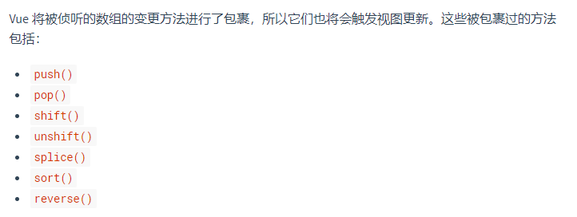
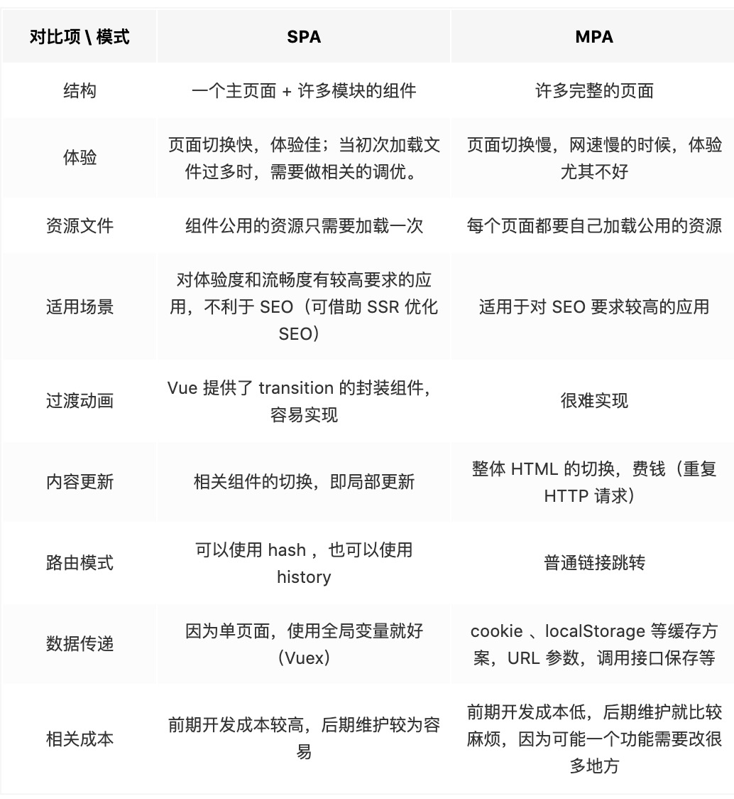
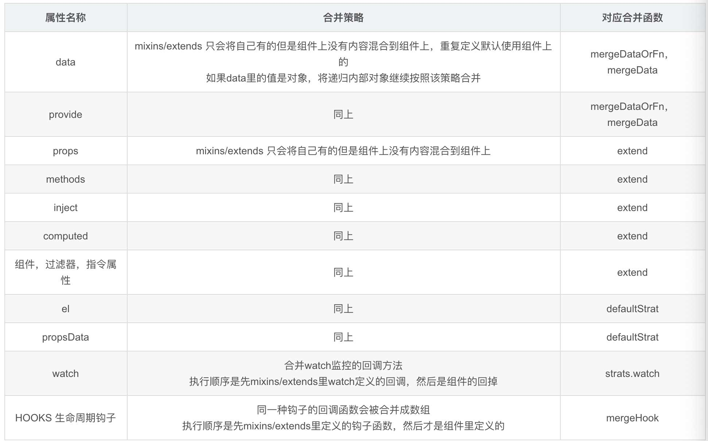

# Vue 基础

## 1. Vue的基本原理

### Vue2

**数据劫持**： 组件实例创建时，Vue 会**递归遍历 `data` 及其嵌套对象**，用 **`Object.defineProperty`** 为每个属性添加 getter/setter。(如果是数组，会重写它的七个原型方法)

**依赖收集**：渲染 watcher 执行渲染函数时**访问数据会触发 getter**，getter 把当前 watcher 加入该属性的 Dep 中。

> 每个组件实例对应一个**渲染 watcher**，它负责组件的渲染。 每个属性内部有一个 **Dep（依赖收集器）**，用来存 watcher。 

**派发更新**:  当数据被修改时，触发 **setter**，setter 调用 `dep.notify()`，通知 Dep 里所有 watcher 执行 `update()`，`update()` 会把更新推入异步队列，在 `nextTick` 里批量执行，最终重新渲染组件。


### Vue3

**数据代理**：组件实例创建时，Vue 3 用 **`Proxy`** 代理整个对象，配合 **`Reflect`** 操作属性。`Proxy` 会拦截对象的 `get` / `set` 等操作。**它是惰性的**：访问到嵌套对象时，才为它创建代理，不像 Vue 2 那样初始化时递归遍历。

> Vue 3 内部通过 **`track`** 收集依赖，依赖关系存在全局的 **`targetMap`** 中，结构是 `WeakMap<对象, Map<属性, Dep>>`。
>
> 数组不需要重写方法，因为 `Proxy` 能直接拦截索引和长度的修改。

**依赖收集**：渲染 `effect` 执行渲染函数时**访问数据会触发 `get` 拦截器**，`get` 把当前 effect 加入该属性的 Dep 中。

> 每个组件实例对应一个**渲染 effect**，它负责组件的渲染。
>
> 依赖收集和更新由 **`effect`** 负责，它相当于 Vue 2 的 watcher。
>
> effect（泛指）
>   ├─ 渲染 effect       ← 每个组件一个，负责渲染
>   ├─ 计算 effect       ← computed 用
>   └─ 用户 effect       ← watch 用

**派发更新**：当数据被修改时，触发 **`set` 拦截器**，`set` 调用 `trigger`，通知 Dep 里所有 effect 执行 `update()`。`update()` 会把更新推入异步队列，在 `nextTick` 里批量执行，最终重新渲染组件。


## 2. Vue3为什么从 Object.defineProperty() 换成Proxy？

主要两个原因：

1. `Object.defineProperty` **性能较差**：Vue 2 **初始化时**必须**递归遍历**所有属性

2. `Object.defineProperty` **只能劫持已经存在的属性**

   

对象新增，删除属性，以及通过索引修改数组元素，改length无法检测到例如：

- 通过**下标修改数组**（`arr[0] = 1`）
- 修改**数组长度**（`arr.length = 0`）
- 给对象**新增属性**（`obj.newKey = 1`）

虽然 Vue 2 对数组的 `push`、`pop` 等 7 个方法做了重写，但下标修改和长度修改仍然检测不到，需要用 `Vue.set` 或 `splice`。

Vue 3 改用 `Proxy`解决了以上问题 : 

1. 代理整个对象，**惰性创建**，访问到嵌套对象才代理，不用初始化时递归遍历
2. `Proxy` 能拦截**任何方式**的属性操作——新增、删除、数组下标、长度修改，都能监听到。


## 3. Computed 和 Watch 的区别

**Computed（计算属性）** 

- 用于根据已有数据计算出一个新值，它的值必须通过同步返回，因此**不支持异步操作**——如果写成 `async`，返回的是 Promise 而不是计算后的值。

- **有缓存机制**，只有当依赖的响应式数据发生变化时才会重新计算，依赖不变时直接复用上次的结果，避免重复计算。它的执行时机是“被读取时”。

Computed 适用于由其他数据推导出来的值，比如总价、过滤后的列表等场景。

**Watch（侦听器）** 

- 用于监听某个数据的变化，并在变化时执行相应的操作，它本身**没有返回值**，也**不具备缓存机制**，**只要被监听的数据发生变化，回调就会执行**。

- **支持异步**操作，可以在回调中发起请求、读写本地存储或执行其他副作用。它的回调接收两个参数：新值和旧值。

  > Watch 还支持两个常用选项：`immediate` 表示组件加载时立即执行一次回调，`deep` 表示深度监听对象或数组内部的变化。

Watch 适用于数据变化后需要执行动作的场景，比如搜索时发请求、自动保存草稿等。


## 4. slot是什么？有什么作用？

slot 又名插槽，是 Vue 的**内容分发机制**。子组件用 `<slot>` 作为占位出口，**是否显示、怎么显示由亲组件决定**。

slot 分三类：

- **默认插槽**：不指定 `name`，通常只写一个。
- **具名插槽**：带 `name` 属性，一个组件可以有多个。
- **作用域插槽**：默认/具名插槽的变体。子组件渲染时，**把内部数据传给亲组件，亲组件根据这些数据决定如何渲染**。


## 5. 如何保存页面的当前的状态

要保持页面的状态（也就是组件的状态），会出现以下两种情况：

* 组件会被卸载
* 组件不会被卸载

那么可以按照这两种情况分别得到以下方法：

### **组件会被卸载：**

#### **（1）将状态存储在localStorage / sessionStorage**

在组件卸载前的钩子里（Vue 2 `beforeDestroy` / Vue 3 `beforeUnmount` / React `componentWillUnmount`），把组件状态通过 `JSON.stringify()` 存进 Storage。

比如从 B 组件跳转到 A 组件时，我们希望 A 组件恢复之前的状态；但如果从其他组件跳转到 A 组件，我们希望 A 组件重新渲染，不读 Storage。所以需要加一个 flag 判断这次进入 A 是不是来自 B。

**优点**

* 兼容性好，不需要额外库。简单快捷，基本可以满足大部分需求。

**缺点**

- JSON 方法序列化后，`Date`、`RegExp` 等会丢失类型，`undefined`、函数、`Symbol` 会丢失，循环引用会报错。

* 如果 B 组件后退或者下一页跳转并不是前组件，那么 flag 判断会失效，导致从其他页面进入 A 组件页面时 A 组件会重新读取 Storage，会造成很奇怪的现象

#### **（2）路由传值**

通过 react-router 的 Link 组件的 prop —— to 可以实现路由间传递参数的效果。

在这里需要用到 state 参数，在 B 组件中通过 history.location.state 就可以拿到 state 值，保存它。返回 A 组件时再次携带 state 达到路由状态保持的效果。

**优点**

* 简单快捷，不会污染 LocalStorage / SessionStorage。
* 可以传递 Date、RegExp 等特殊对象（不用担心 JSON.stringify / parse 的不足）

**缺点**

* 如果 A 组件可以跳转至多个组件，那么在每一个跳转组件内都要写相同的逻辑。

### **组件不会被卸载：**

#### **（1）单页面渲染**

要切换的组件作为子组件全屏渲染，父组件中正常储存页面状态。

#### 优点

* 代码量少
* 不需要考虑状态传递过程中的错误

#### 缺点

* 增加 A 组件维护成本
* 需要传入额外的 prop 到 B 组件
* 无法利用路由定位页面

除此之外，在Vue中，还可以是用keep-alive来缓存页面，当组件在keep-alive内被切换时组件的**activated、deactivated**这两个生命周期钩子函数会被执行

被包裹在keep-alive中的组件的状态将会被保留：

```javascript
<keep-alive>
	<router-view v-if="$route.meta.keepAlive"></router-view>
</keep-alive>
```

**router.js**

```javascript
{
  path: '/',
  name: 'xxx',
  component: ()=>import('../src/views/xxx.vue'),
  meta:{
    keepAlive: true // 需要被缓存
  }
},
```

## 10. 常见的事件修饰符及其作用

* `.stop`：等同于 JavaScript 中的 `event.stopPropagation()` ，防止事件冒泡；
* `.prevent` ：等同于 JavaScript 中的 `event.preventDefault()` ，防止执行预设的行为（如果事件可取消，则取消该事件，而不停止事件的进一步传播）；
* `.capture` ：与事件冒泡的方向相反，事件捕获由外到内；
* `.self` ：只会触发自己范围内的事件，不包含子元素；
* `.once` ：只会触发一次。

## 11. v-if、v-show、v-html 的原理

* v-if会调用addIfCondition方法，生成vnode的时候会忽略对应节点，render的时候就不会渲染；
* v-show会生成vnode，render的时候也会渲染成真实节点，只是在render过程中会在节点的属性中修改show属性值，也就是常说的display；
* v-html会先移除节点下的所有节点，调用html方法，通过addProp添加innerHTML属性，归根结底还是设置innerHTML为v-html的值。

## 13. v-if和v-show的区别

* **手段**：v-if是动态的向DOM树内添加或者删除DOM元素；v-show是通过设置DOM元素的display样式属性控制显隐；
* **编译过程**：v-if切换有一个局部编译/卸载的过程，切换过程中合适地销毁和重建内部的事件监听和子组件；v-show只是简单的基于css切换；
* **编译条件**：v-if是惰性的，如果初始条件为假，则什么也不做；只有在条件第一次变为真时才开始局部编译; v-show是在任何条件下，无论首次条件是否为真，都被编译，然后被缓存，而且DOM元素保留；
* **性能消耗**：v-if有更高的切换消耗；v-show有更高的初始渲染消耗；
* **使用场景**：v-if适合运营条件不大可能改变；v-show适合频繁切换。

## 14. v-model 是如何实现的，语法糖实际是什么？

**（1）作用在表单元素上**

动态绑定了 input 的 value 指向了 messgae 变量，并且在触发 input 事件的时候去动态把 message设置为目标值：

```javascript
<input v-model="sth" />
//  等同于
<input 
    v-bind:value="message" 
    v-on:input="message=$event.target.value"
>
//$event 指代当前触发的事件对象;
//$event.target 指代当前触发的事件对象的dom;
//$event.target.value 就是当前dom的value值;
//在@input方法中，value => sth;
//在:value中,sth => value;
```

**（2）作用在组件上**

在自定义组件中，v-model 默认会利用名为 value 的 prop和名为 input 的事件

**本质是一个父子组件通信的语法糖，通过prop和$.emit实现。**因此父组件 v-model 语法糖本质上可以修改为：

```javascript
<child :value="message"  @input="function(e){message = e}"></child>
```

在组件的实现中，可以通过 v-model属性来配置子组件接收的prop名称，以及派发的事件名称。

例子：

```javascript
// 父组件
<aa-input v-model="aa"></aa-input>
// 等价于
<aa-input v-bind:value="aa" v-on:input="aa=$event.target.value"></aa-input>

// 子组件：
<input v-bind:value="aa" v-on:input="onmessage"></aa-input>

props:{value:aa,}
methods:{
    onmessage(e){
        $emit('input',e.target.value)
    }
}
```

默认情况下，一个组件上的v-model 会把 value 用作 prop且把 input 用作 event。但是一些输入类型比如单选框和复选框按钮可能想使用 value prop 来达到不同的目的。使用 model 选项可以回避这些情况产生的冲突。js 监听input 输入框输入数据改变，用oninput，数据改变以后就会立刻出发这个事件。通过input事件把数据$emit 出去，在父组件接受。父组件设置v-model的值为input $emit过来的值。

## 15. v-model 可以被用在自定义组件上吗？如果可以，如何使用？

可以。v-model 实际上是一个语法糖，如：

```javascript
<input v-model="searchText">
```

实际上相当于：

```javascript
<input
  v-bind:value="searchText"
  v-on:input="searchText = $event.target.value"
>
```

用在自定义组件上也是同理：

```javascript
<custom-input v-model="searchText">
```

相当于：

```javascript
<custom-input
  v-bind:value="searchText"
  v-on:input="searchText = $event"
></custom-input>
```

显然，custom-input 与父组件的交互如下：

1. 父组件将`searchText`变量传入custom-input 组件，使用的 prop 名为`value`；
2. custom-input 组件向父组件传出名为`input`的事件，父组件将接收到的值赋值给`searchText`；

所以，custom-input 组件的实现应该类似于这样：

```javascript
Vue.component('custom-input', {
  props: ['value'],
  template: `
    <input
      v-bind:value="value"
      v-on:input="$emit('input', $event.target.value)"
    >
  `
})
```


  ## 16. data为什么是一个函数而不是对象

  Vue组件可能存在多个实例，如果使用对象形式定义data，则会导致它们共用一个data对象，那么状态变更将会影响所有组件实例，这是不合理的；采用函数形式定义，在initData时会将其作为工厂函数返回全新data对象，有效规避多实例之间状态污染问题。而在Vue根实例创建过程中则不存在该限制，也是因为根实例只能有一个，不需要担心这种情况。

  ## 17. 对keep-alive的理解，它是如何实现的，具体缓存的是什么？

  如果需要在组件切换的时候，保存一些组件的状态防止多次渲染，就可以使用 keep-alive 组件包裹需要保存的组件。

  **（1）****keep-alive**

  keep-alive有以下三个属性：

  * include 字符串或正则表达式，只有名称匹配的组件会被匹配；
  * exclude 字符串或正则表达式，任何名称匹配的组件都不会被缓存；
  * max 数字，最多可以缓存多少组件实例。

  注意：keep-alive 包裹动态组件时，会缓存不活动的组件实例。

  **主要流程**

  1. 判断组件 name ，不在 include 或者在 exclude 中，直接返回 vnode，说明该组件不被缓存。
  2. 获取组件实例 key ，如果有获取实例的 key，否则重新生成。
  3. key生成规则，cid +"∶∶"+ tag ，仅靠cid是不够的，因为相同的构造函数可以注册为不同的本地组件。
  4. 如果缓存对象内存在，则直接从缓存对象中获取组件实例给 vnode ，不存在则添加到缓存对象中。 5.最大缓存数量，当缓存组件数量超过 max 值时，清除 keys 数组内第一个组件。

  **（2）keep-alive 的实现**

  ```javascript
  const patternTypes: Array<Function> = [String, RegExp, Array] // 接收：字符串，正则，数组
  
  export default {
    name: 'keep-alive',
    abstract: true, // 抽象组件，是一个抽象组件：它自身不会渲染一个 DOM 元素，也不会出现在父组件链中。
  
    props: {
      include: patternTypes, // 匹配的组件，缓存
      exclude: patternTypes, // 不去匹配的组件，不缓存
      max: [String, Number], // 缓存组件的最大实例数量, 由于缓存的是组件实例（vnode），数量过多的时候，会占用过多的内存，可以用max指定上限
    },
  
    created() {
      // 用于初始化缓存虚拟DOM数组和vnode的key
      this.cache = Object.create(null)
      this.keys = []
    },
  
    destroyed() {
      // 销毁缓存cache的组件实例
      for (const key in this.cache) {
        pruneCacheEntry(this.cache, key, this.keys)
      }
    },
  
    mounted() {
      // prune 削减精简[v.]
      // 去监控include和exclude的改变，根据最新的include和exclude的内容，来实时削减缓存的组件的内容
      this.$watch('include', (val) => {
        pruneCache(this, (name) => matches(val, name))
      })
      this.$watch('exclude', (val) => {
        pruneCache(this, (name) => !matches(val, name))
      })
    },
  }
  ```

  **render函数：**

  1. 会在 keep-alive 组件内部去写自己的内容，所以可以去获取默认 slot 的内容，然后根据这个去获取组件
  2. keep-alive 只对第一个组件有效，所以获取第一个子组件。
  3. 和 keep-alive 搭配使用的一般有：动态组件 和router-view

  ```javascript
  render () {
    //
    function getFirstComponentChild (children: ?Array<VNode>): ?VNode {
      if (Array.isArray(children)) {
    for (let i = 0; i < children.length; i++) {
      const c = children[i]
      if (isDef(c) && (isDef(c.componentOptions) || isAsyncPlaceholder(c))) {
        return c
      }
    }
    }
    }
    const slot = this.$slots.default // 获取默认插槽
    const vnode: VNode = getFirstComponentChild(slot)// 获取第一个子组件
    const componentOptions: ?VNodeComponentOptions = vnode && vnode.componentOptions // 组件参数
    if (componentOptions) { // 是否有组件参数
      // check pattern
      const name: ?string = getComponentName(componentOptions) // 获取组件名
      const { include, exclude } = this
      if (
        // not included
        (include && (!name || !matches(include, name))) ||
        // excluded
        (exclude && name && matches(exclude, name))
      ) {
        // 如果不匹配当前组件的名字和include以及exclude
        // 那么直接返回组件的实例
        return vnode
      }
  
      const { cache, keys } = this
  
      // 获取这个组件的key
      const key: ?string = vnode.key == null
        // same constructor may get registered as different local components
        // so cid alone is not enough (#3269)
        ? componentOptions.Ctor.cid + (componentOptions.tag ? `::${componentOptions.tag}` : '')
        : vnode.key
  
      if (cache[key]) {
        // LRU缓存策略执行
        vnode.componentInstance = cache[key].componentInstance // 组件初次渲染的时候componentInstance为undefined
  
        // make current key freshest
        remove(keys, key)
        keys.push(key)
        // 根据LRU缓存策略执行，将key从原来的位置移除，然后将这个key值放到最后面
      } else {
        // 在缓存列表里面没有的话，则加入，同时判断当前加入之后，是否超过了max所设定的范围，如果是，则去除
        // 使用时间间隔最长的一个
        cache[key] = vnode
        keys.push(key)
        // prune oldest entry
        if (this.max && keys.length > parseInt(this.max)) {
          pruneCacheEntry(cache, keys[0], keys, this._vnode)
        }
      }
      // 将组件的keepAlive属性设置为true
      vnode.data.keepAlive = true // 作用：判断是否要执行组件的created、mounted生命周期函数
    }
    return vnode || (slot && slot[0])
  }
  ```

  keep-alive 具体是通过 cache 数组缓存所有组件的 vnode 实例。当 cache 内原有组件被使用时会将该组件 key 从 keys 数组中删除，然后 push 到 keys数组最后，以便清除最不常用组件。

  **实现步骤：**

  1. 获取 keep-alive 下第一个子组件的实例对象，通过他去获取这个组件的组件名
  2. 通过当前组件名去匹配原来 include 和 exclude，判断当前组件是否需要缓存，不需要缓存，直接返回当前组件的实例vNode
  3. 需要缓存，判断他当前是否在缓存数组里面：

  * 存在，则将他原来位置上的 key 给移除，同时将这个组件的 key 放到数组最后面（LRU）
  * 不存在，将组件 key 放入数组，然后判断当前 key数组是否超过 max 所设置的范围，超过，那么削减未使用时间最长的一个组件的 key

  4. 最后将这个组件的 keepAlive 设置为 true

  **（3）keep-alive 本身的创建过程和 patch 过程**

  缓存渲染的时候，会根据 vnode.componentInstance（首次渲染 vnode.componentInstance 为 undefined） 和 keepAlive 属性判断不会执行组件的 created、mounted 等钩子函数，而是对缓存的组件执行 patch 过程∶ 直接把缓存的 DOM 对象直接插入到目标元素中，完成了数据更新的情况下的渲染过程。

  **首次渲染**

  * 组件的首次渲染∶判断组件的 abstract 属性，才往父组件里面挂载 DOM

  ```javascript
  // core/instance/lifecycle
  function initLifecycle (vm: Component) {
    const options = vm.$options
  
    // locate first non-abstract parent
    let parent = options.parent
    if (parent && !options.abstract) { // 判断组件的abstract属性，才往父组件里面挂载DOM
      while (parent.$options.abstract && parent.$parent) {
        parent = parent.$parent
      }
      parent.$children.push(vm)
    }
  
    vm.$parent = parent
    vm.$root = parent ? parent.$root : vm
  
    vm.$children = []
    vm.$refs = {}
  
    vm._watcher = null
    vm._inactive = null
    vm._directInactive = false
    vm._isMounted = false
    vm._isDestroyed = false
    vm._isBeingDestroyed = false
  }
  ```

  * 判断当前 keepAlive 和 componentInstance 是否存在来判断是否要执行组件 prepatch 还是执行创建 componentlnstance

  ```javascript
  // core/vdom/create-component
  init (vnode: VNodeWithData, hydrating: boolean): ?boolean {
      if (
        vnode.componentInstance &&
        !vnode.componentInstance._isDestroyed &&
        vnode.data.keepAlive
      ) { // componentInstance在初次是undefined!!!
        // kept-alive components, treat as a patch
        const mountedNode: any = vnode // work around flow
        componentVNodeHooks.prepatch(mountedNode, mountedNode) // prepatch函数执行的是组件更新的过程
      } else {
        const child = vnode.componentInstance = createComponentInstanceForVnode(
          vnode,
          activeInstance
        )
        child.$mount(hydrating ? vnode.elm : undefined, hydrating)
      }
    },
  ```

  prepatch 操作就不会在执行组件的 mounted 和 created 生命周期函数，而是直接将 DOM 插入

  **（4）LRU （least recently used）缓存策略**

  LRU 缓存策略∶ 从内存中找出最久未使用的数据并置换新的数据。

  LRU（Least rencently used）算法根据数据的历史访问记录来进行淘汰数据，其核心思想是**"如果数据最近被访问过，那么将来被访问的几率也更高"**。 最常见的实现是使用一个链表保存缓存数据，详细算法实现如下∶

  * 新数据插入到链表头部
  * 每当缓存命中（即缓存数据被访问），则将数据移到链表头部
  * 链表满的时候，将链表尾部的数据丢弃。

  ## 18. $nextTick 原理及作用

  Vue 的 nextTick 其本质是对 JavaScript 执行原理 EventLoop 的一种应用。

  nextTick 的核心是利用了如 Promise 、MutationObserver、setImmediate、setTimeout的原生 JavaScript 方法来模拟对应的微/宏任务的实现，本质是为了利用 JavaScript 的这些异步回调任务队列来实现 Vue 框架中自己的异步回调队列。

  nextTick 不仅是 Vue 内部的异步队列的调用方法，同时也允许开发者在实际项目中使用这个方法来满足实际应用中对 DOM 更新数据时机的后续逻辑处理

  nextTick 是典型的将底层 JavaScript 执行原理应用到具体案例中的示例，引入异步更新队列机制的原因∶

  * 如果是同步更新，则多次对一个或多个属性赋值，会频繁触发 UI/DOM 的渲染，可以减少一些无用渲染
  * 同时由于 VirtualDOM 的引入，每一次状态发生变化后，状态变化的信号会发送给组件，组件内部使用 VirtualDOM 进行计算得出需要更新的具体的 DOM 节点，然后对 DOM 进行更新操作，每次更新状态后的渲染过程需要更多的计算，而这种无用功也将浪费更多的性能，所以异步渲染变得更加至关重要

  Vue采用了数据驱动视图的思想，但是在一些情况下，仍然需要操作DOM。有时候，可能遇到这样的情况，DOM1的数据发生了变化，而DOM2需要从DOM1中获取数据，那这时就会发现DOM2的视图并没有更新，这时就需要用到了`nextTick`了。

  由于Vue的DOM操作是异步的，所以，在上面的情况中，就要将DOM2获取数据的操作写在`$nextTick`中。

  ```javascript
  this.$nextTick(() => {
      // 获取数据的操作...
  })
  ```

  所以，在以下情况下，会用到nextTick：

  * 在数据变化后执行的某个操作，而这个操作需要使用随数据变化而变化的DOM结构的时候，这个操作就需要方法在`nextTick()`的回调函数中。
  * 在vue生命周期中，如果在created()钩子进行DOM操作，也一定要放在`nextTick()`的回调函数中。

  因为在created()钩子函数中，页面的DOM还未渲染，这时候也没办法操作DOM，所以，此时如果想要操作DOM，必须将操作的代码放在`nextTick()`的回调函数中。

  ## **19. Vue 中给 data 中的对象属性添加一个新的属性时会发生什么？如何解决？**

  ```javascript
  <template> 
     <div>
        <ul>
           <li v-for="value in obj" :key="value"> {{value}} </li> 
        </ul> 
        <button @click="addObjB">添加 obj.b</button> 
     </div>
  </template>
  
  <script>
      export default { 
         data () { 
            return { 
                obj: { 
                    a: 'obj.a' 
                } 
            } 
         },
         methods: { 
            addObjB () { 
                this.obj.b = 'obj.b' 
                console.log(this.obj) 
            } 
        }
     }
  </script>
  ```

  点击 button 会发现，obj.b 已经成功添加，但是视图并未刷新。这是因为在Vue实例创建时，obj.b并未声明，因此就没有被Vue转换为响应式的属性，自然就不会触发视图的更新，这时就需要使用Vue的全局 api **$set()：**

  ```javascript
  addObjB () (
     this.$set(this.obj, 'b', 'obj.b')
     console.log(this.obj)
  }
  ```

  $set()方法相当于手动的去把obj.b处理成一个响应式的属性，此时视图也会跟着改变了。

  ## 20. Vue中封装的数组方法有哪些，其如何实现页面更新

  在Vue中，对响应式处理利用的是Object.defineProperty对数据进行拦截，而这个方法并不能监听到数组内部变化，数组长度变化，数组的截取变化等，所以需要对这些操作进行hack，让Vue能监听到其中的变化。

  

  那Vue是如何实现让这些数组方法实现元素的实时更新的呢，下面是Vue中对这些方法的封装：

  ```javascript
  // 缓存数组原型
  const arrayProto = Array.prototype;
  // 实现 arrayMethods.__proto__ === Array.prototype
  export const arrayMethods = Object.create(arrayProto);
  // 需要进行功能拓展的方法
  const methodsToPatch = [
    "push",
    "pop",
    "shift",
    "unshift",
    "splice",
    "sort",
    "reverse"
  ];
  
  /**
   * Intercept mutating methods and emit events
   */
  methodsToPatch.forEach(function(method) {
    // 缓存原生数组方法
    const original = arrayProto[method];
    def(arrayMethods, method, function mutator(...args) {
      // 执行并缓存原生数组功能
      const result = original.apply(this, args);
      // 响应式处理
      const ob = this.__ob__;
      let inserted;
      switch (method) {
      // push、unshift会新增索引，所以要手动observer
        case "push":
        case "unshift":
          inserted = args;
          break;
        // splice方法，如果传入了第三个参数，也会有索引加入，也要手动observer。
        case "splice":
          inserted = args.slice(2);
          break;
      }
      // 
      if (inserted) ob.observeArray(inserted);// 获取插入的值，并设置响应式监听
      // notify change
      ob.dep.notify();// 通知依赖更新
      // 返回原生数组方法的执行结果
      return result;
    });
  });
  ```

  简单来说就是，重写了数组中的那些原生方法，首先获取到这个数组的\_\_ob\_\_，也就是它的Observer对象，如果有新的值，就调用observeArray继续对新的值观察变化（也就是通过`target__proto__ == arrayMethods`来改变了数组实例的型），然后手动调用notify，通知渲染watcher，执行update。

  ## 21. Vue 单页应用与多页应用的区别

  **概念：**

  * SPA单页面应用（SinglePage Web Application），指只有一个主页面的应用，一开始只需要加载一次js、css等相关资源。所有内容都包含在主页面，对每一个功能模块组件化。单页应用跳转，就是切换相关组件，仅仅刷新局部资源。
  * MPA多页面应用 （MultiPage Application），指有多个独立页面的应用，每个页面必须重复加载js、css等相关资源。多页应用跳转，需要整页资源刷新。

  **区别：**

  

  ## 22. Vue template 到 render 的过程

  vue的模版编译过程主要如下：**template -> ast -> render函数**

  vue 在模版编译版本的码中会执行 compileToFunctions 将template转化为render函数：

  ```javascript
  // 将模板编译为render函数
  const { render, staticRenderFns } = compileToFunctions(template,options//省略}, this)
  ```

  CompileToFunctions中的主要逻辑如下∶

  **（1）调用parse方法将template转化为ast（抽象语法树）**

  ```javascript
  constast = parse(template.trim(), options)
  ```

  * **parse的目标**：把tamplate转换为AST树，它是一种用 JavaScript对象的形式来描述整个模板。
  * **解析过程**：利用正则表达式顺序解析模板，当解析到开始标签、闭合标签、文本的时候都会分别执行对应的 回调函数，来达到构造AST树的目的。

  AST元素节点总共三种类型：type为1表示普通元素、2为表达式、3为纯文本

  **（2）对静态节点做优化**

  ```javascript
  optimize(ast,options)
  ```

  这个过程主要分析出哪些是静态节点，给其打一个标记，为后续更新渲染可以直接跳过静态节点做优化

  深度遍历AST，查看每个子树的节点元素是否为静态节点或者静态节点根。如果为静态节点，他们生成的DOM永远不会改变，这对运行时模板更新起到了极大的优化作用。

  **（3）生成代码**

  ```javascript
  const code = generate(ast, options)
  ```

  generate将ast抽象语法树编译成 render字符串并将静态部分放到 staticRenderFns 中，最后通过 `new Function(`` render``)` 生成render函数。

  ## 23. Vue data 中某一个属性的值发生改变后，视图会立即同步执行重新渲染吗？

  不会立即同步执行重新渲染。Vue 实现响应式并不是数据发生变化之后 DOM 立即变化，而是按一定的策略进行 DOM 的更新。Vue 在更新 DOM 时是异步执行的。只要侦听到数据变化， Vue 将开启一个队列，并缓冲在同一事件循环中发生的所有数据变更。

  如果同一个watcher被多次触发，只会被推入到队列中一次。这种在缓冲时去除重复数据对于避免不必要的计算和 DOM 操作是非常重要的。然后，在下一个的事件循环tick中，Vue 刷新队列并执行实际（已去重的）工作。

  ## 24. 简述 mixin、extends 的覆盖逻辑

  **（1）mixin 和 extends**

  mixin 和 extends均是用于合并、拓展组件的，两者均通过 mergeOptions 方法实现合并。

  * mixins 接收一个混入对象的数组，其中混入对象可以像正常的实例对象一样包含实例选项，这些选项会被合并到最终的选项中。Mixin 钩子按照传入顺序依次调用，并在调用组件自身的钩子之前被调用。
  * extends 主要是为了便于扩展单文件组件，接收一个对象或构造函数。

  

  **（2）mergeOptions 的执行过程**

  * 规范化选项（normalizeProps、normalizelnject、normalizeDirectives)
  * 对未合并的选项，进行判断

  ```javascript
  if(!child._base) {
      if(child.extends) {
          parent = mergeOptions(parent, child.extends, vm)
      }
      if(child.mixins) {
          for(let i = 0, l = child.mixins.length; i < l; i++){
              parent = mergeOptions(parent, child.mixins[i], vm)
          }
      }
  }
  ```

  * 合并处理。根据一个通用 Vue 实例所包含的选项进行分类逐一判断合并，如 props、data、 methods、watch、computed、生命周期等，将合并结果存储在新定义的 options 对象里。
  * 返回合并结果 options。

  ## 25. 描述下Vue自定义指令

  在 Vue2.0 中，代码复用和抽象的主要形式是组件。然而，有的情况下，你仍然需要对普通 DOM 元素进行底层操作，这时候就会用到自定义指令。

  一般需要对DOM元素进行底层操作时使用，尽量只用来操作 DOM展示，不修改内部的值。当使用自定义指令直接修改 value 值时绑定v-model的值也不会同步更新；如必须修改可以在自定义指令中使用keydown事件，在vue组件中使用 change事件，回调中修改vue数据;

  **（1）自定义指令基本内容**

  * 全局定义：`Vue.directive("focus",{})`

  * 局部定义：`directives:{focus:{}}`

  * 钩子函数：指令定义对象提供钩子函数

    ```
    o bind：只调用一次，指令第一次绑定到元素时调用。在这里可以进行一次性的初始化设置。

    o inSerted：被绑定元素插入父节点时调用（仅保证父节点存在，但不一定已被插入文档中）。

    o update：所在组件的VNode更新时调用，但是可能发生在其子VNode更新之前调用。指令的值可能发生了改变，也可能没有。但是可以通过比较更新前后的值来忽略不必要的模板更新。

    o ComponentUpdate：指令所在组件的 VNode及其子VNode全部更新后调用。

    o unbind：只调用一次，指令与元素解绑时调用。
    ```

  * 钩子函数参数

    ```
    o el：绑定元素
    
    o bing： 指令核心对象，描述指令全部信息属性
    
    o name
    
    o value
    
    o oldValue
    
    o expression
    
    o arg
    
    o modifers
    
    o vnode  虚拟节点
    
    o oldVnode：上一个虚拟节点（更新钩子函数中才有用）
    ```

  **（2）使用场景**

  * 普通DOM元素进行底层操作的时候，可以使用自定义指令
  * 自定义指令是用来操作DOM的。尽管Vue推崇数据驱动视图的理念，但并非所有情况都适合数据驱动。自定义指令就是一种有效的补充和扩展，不仅可用于定义任何的DOM操作，并且是可复用的。

  **（3）使用案例**

  初级应用：

  * 鼠标聚焦
  * 下拉菜单
  * 相对时间转换
  * 滚动动画

  高级应用：

  * 自定义指令实现图片懒加载
  * 自定义指令集成第三方插件


  ## 26. 子组件可以直接改变父组件的数据吗？

  子组件不可以直接改变父组件的数据。这样做主要是为了维护父子组件的单向数据流。每次父级组件发生更新时，子组件中所有的 prop 都将会刷新为最新的值。如果这样做了，Vue 会在浏览器的控制台中发出警告。

  Vue提倡单向数据流，即父级 props 的更新会流向子组件，但是反过来则不行。这是为了防止意外的改变父组件状态，使得应用的数据流变得难以理解，导致数据流混乱。如果破坏了单向数据流，当应用复杂时，debug 的成本会非常高。

  **只能通过 `$emit` 派发一个自定义事件，父组件接收到后，由父组件修改。**

  ## 27. Vue是如何收集依赖的？

  在初始化 Vue 的每个组件时，会对组件的 data 进行初始化，就会将由普通对象变成响应式对象，在这个过程中便会进行依赖收集的相关逻辑，如下所示∶

  ```javascript
  function defieneReactive (obj, key, val){
    const dep = new Dep();
    ...
    Object.defineProperty(obj, key, {
      ...
      get: function reactiveGetter () {
        if(Dep.target){
          dep.depend();
          ...
        }
        return val
      }
      ...
    })
  }
  ```

  以上只保留了关键代码，主要就是 `const dep = new Dep()`实例化一个 Dep 的实例，然后在 get 函数中通过 `dep.depend()` 进行依赖收集。

  **（1）Dep**

  Dep是整个依赖收集的核心，其关键代码如下：

  ```javascript
  class Dep {
    static target;
    subs;
  
    constructor () {
      ...
      this.subs = [];
    }
    addSub (sub) {
      this.subs.push(sub)
    }
    removeSub (sub) {
      remove(this.sub, sub)
    }
    depend () {
      if(Dep.target){
        Dep.target.addDep(this)
      }
    }
    notify () {
      const subs = this.subds.slice();
      for(let i = 0;i < subs.length; i++){
        subs[i].update()
      }
    }
  }
  ```

  Dep 是一个 class ，其中有一个关 键的静态属性 static，它指向了一个全局唯一 Watcher，保证了同一时间全局只有一个 watcher 被计算，另一个属性 subs 则是一个 Watcher 的数组，所以 Dep 实际上就是对 Watcher 的管理，再看看 Watcher 的相关代码∶

  **（2）Watcher**

  ```javascript
  class Watcher {
    getter;
    ...
    constructor (vm, expression){
      ...
      this.getter = expression;
      this.get();
    }
    get () {
      pushTarget(this);
      value = this.getter.call(vm, vm)
      ...
      return value
    }
    addDep (dep){
          ...
      dep.addSub(this)
    }
    ...
  }
  function pushTarget (_target) {
    Dep.target = _target
  }
  ```

  Watcher 是一个 class，它定义了一些方法，其中和依赖收集相关的主要有 get、addDep 等。

  **（3）过程**

  在实例化 Vue 时，依赖收集的相关过程如下∶

  初 始 化 状 态 initState ， 这 中 间 便 会 通 过 defineReactive 将数据变成响应式对象，其中的 getter 部分便是用来依赖收集的。

  初始化最终会走 mount 过程，其中会实例化 Watcher ，进入 Watcher 中，便会执行 this.get() 方法，

  ```javascript
  updateComponent = () => {
    vm._update(vm._render())
  }
  new Watcher(vm, updateComponent)
  ```

  get 方法中的 pushTarget 实际上就是把 Dep.target 赋值为当前的 watcher。

  this.getter.call（vm，vm），这里的 getter 会执行 vm.\_render() 方法，在这个过程中便会触发数据对象的 getter。那么每个对象值的 getter 都持有一个 dep，在触发 getter 的时候会调用 dep.depend() 方法，也就会执行 Dep.target.addDep(this)。刚才 Dep.target 已经被赋值为 watcher，于是便会执行 addDep 方法，然后走到 dep.addSub() 方法，便将当前的 watcher 订阅到这个数据持有的 dep 的 subs 中，这个目的是为后续数据变化时候能通知到哪些 subs 做准备。所以在 vm.\_render() 过程中，会触发所有数据的 getter，这样便已经完成了一个依赖收集的过程。

  ## 28. 对 React 和 Vue 的理解，它们的异同

  **相似之处：**

  * 都将注意力集中保持在核心库，而将其他功能如路由和全局状态管理交给相关的库；
  * 都有自己的构建工具，能让你得到一个根据最佳实践设置的项目模板；
  * 都使用了Virtual DOM（虚拟DOM）提高重绘性能；
  * 都有props的概念，允许组件间的数据传递；
  * 都鼓励组件化应用，将应用分拆成一个个功能明确的模块，提高复用性。

  **不同之处 ：**

  **1）数据流**

  Vue默认支持数据双向绑定，而React一直提倡单向数据流

  **2）虚拟DOM**

  Vue2.x开始引入"Virtual DOM"，消除了和React在这方面的差异，但是在具体的细节还是有各自的特点。

  * Vue宣称可以更快地计算出Virtual DOM的差异，这是由于它在渲染过程中，会跟踪每一个组件的依赖关系，不需要重新渲染整个组件树。
  * 对于React而言，每当应用的状态被改变时，全部子组件都会重新渲染。当然，这可以通过 PureComponent/shouldComponentUpdate这个生命周期方法来进行控制，但Vue将此视为默认的优化。

  **3）组件化**

  React与Vue最大的不同是模板的编写。

  * Vue鼓励写近似常规HTML的模板。写起来很接近标准 HTML元素，只是多了一些属性。
  * React推荐你所有的模板通用JavaScript的语法扩展——JSX书写。

  具体来讲：React中render函数是支持闭包特性的，所以import的组件在render中可以直接调用。但是在Vue中，由于模板中使用的数据都必须挂在 this 上进行一次中转，所以 import 一个组件完了之后，还需要在 components 中再声明下。

  **4）监听数据变化的实现原理不同**

  * Vue 通过 getter/setter 以及一些函数的劫持，能精确知道数据变化，不需要特别的优化就能达到很好的性能
  * React 默认是通过比较引用的方式进行的，如果不优化（PureComponent/shouldComponentUpdate）可能导致大量不必要的vDOM的重新渲染。这是因为 Vue 使用的是可变数据，而React更强调数据的不可变。

  **5）高阶组件**

  react可以通过高阶组件（HOC）来扩展，而Vue需要通过mixins来扩展。

  高阶组件就是高阶函数，而React的组件本身就是纯粹的函数，所以高阶函数对React来说易如反掌。相反Vue.js使用HTML模板创建视图组件，这时模板无法有效的编译，因此Vue不能采用HOC来实现。

  **6）构建工具**

  两者都有自己的构建工具：

  * React ==> Create React APP
  * Vue ==> vue-cli

  **7）跨平台**

  * React ==> React Native
  * Vue ==> Weex

  ## 29. Vue的优点

  * 轻量级框架：只关注视图层，是一个构建数据的视图集合，大小只有几十 `kb` ；
  * 简单易学：国人开发，中文文档，不存在语言障碍 ，易于理解和学习；
  * 双向数据绑定：保留了 `angular` 的特点，在数据操作方面更为简单；
  * 组件化：保留了 `react` 的优点，实现了 `html` 的封装和重用，在构建单页面应用方面有着独特的优势；
  * 视图，数据，结构分离：使数据的更改更为简单，不需要进行逻辑代码的修改，只需要操作数据就能完成相关操作；
  * 虚拟DOM：`dom` 操作是非常耗费性能的，不再使用原生的 `dom` 操作节点，极大解放 `dom` 操作，但具体操作的还是 `dom` 不过是换了另一种方式；
  * 运行速度更快：相比较于 `react` 而言，同样是操作虚拟 `dom`，就性能而言， `vue` 存在很大的优势。

  ## 30. assets和static的区别

  **相同点：** `assets` 和 `static` 两个都是存放静态资源文件。项目中所需要的资源文件图片，字体图标，样式文件等都可以放在这两个文件下，这是相同点

  **不相同点：**`assets` 中存放的静态资源文件在项目打包时，也就是运行 `npm run build` 时会将 `assets` 中放置的静态资源文件进行打包上传，所谓打包简单点可以理解为压缩体积，代码格式化。而压缩后的静态资源文件最终也都会放置在 `static` 文件中跟着 `index.html` 一同上传至服务器。`static` 中放置的静态资源文件就不会要走打包压缩格式化等流程，而是直接进入打包好的目录，直接上传至服务器。因为避免了压缩直接进行上传，在打包时会提高一定的效率，但是 `static` 中的资源文件由于没有进行压缩等操作，所以文件的体积也就相对于 `assets` 中打包后的文件提交较大点。在服务器中就会占据更大的空间。

  **建议：** 将项目中 `template`需要的样式文件js文件等都可以放置在 `assets` 中，走打包这一流程。减少体积。而项目中引入的第三方的资源文件如`iconfoont.css` 等文件可以放置在 `static` 中，因为这些引入的第三方文件已经经过处理，不再需要处理，直接上传。


  ## 31. delete和Vue.delete删除数组的区别

  * `delete` 只是被删除的元素变成了 `empty/undefined` 其他的元素的键值还是不变。
  * `Vue.delete` 直接删除了数组 改变了数组的键值。

  ## 32. vue如何监听对象或者数组某个属性的变化

  当在项目中直接设置数组的某一项的值，或者直接设置对象的某个属性值，这个时候，你会发现页面并没有更新。这是因为Object.defineProperty()限制，监听不到变化。

  解决方式：

  * this.$set(你要改变的数组/对象，你要改变的位置/key，你要改成什么value)

  ```javascript
  this.$set(this.arr, 0, "OBKoro1"); // 改变数组
  this.$set(this.obj, "c", "OBKoro1"); // 改变对象
  ```

  * 调用以下几个数组的方法

  ```javascript
  splice()、 push()、pop()、shift()、unshift()、sort()、reverse()
  ```

  vue源码里缓存了array的原型链，然后重写了这几个方法，触发这几个方法的时候会observer数据，意思是使用这些方法不用再进行额外的操作，视图自动进行更新。 推荐使用splice方法会比较好自定义,因为splice可以在数组的任何位置进行删除/添加操作

  vm.`$set` 的实现原理是：

  * 如果目标是数组，直接使用数组的 splice 方法触发相应式；
  * 如果目标是对象，会先判读属性是否存在、对象是否是响应式，最终如果要对属性进行响应式处理，则是通过调用 defineReactive 方法进行响应式处理（ defineReactive 方法就是 Vue 在初始化对象时，给对象属性采用 Object.defineProperty 动态添加 getter 和 setter 的功能所调用的方法）

  ## 33. 什么是 mixin ？

  * Mixin 使我们能够为 Vue 组件编写可插拔和可重用的功能。
  * 如果希望在多个组件之间重用一组组件选项，例如生命周期 hook、 方法等，则可以将其编写为 mixin，并在组件中简单的引用它。
  * 然后将 mixin 的内容合并到组件中。如果你要在 mixin 中定义生命周期 hook，那么它在执行时将优化于组件自已的 hook。

  ## 34. Vue模版编译原理

  vue中的模板template无法被浏览器解析并渲染，因为这不属于浏览器的标准，不是正确的HTML语法，所有需要将template转化成一个JavaScript函数，这样浏览器就可以执行这一个函数并渲染出对应的HTML元素，就可以让视图跑起来了，这一个转化的过程，就成为模板编译。模板编译又分三个阶段，解析parse，优化optimize，生成generate，最终生成可执行函数render。

  * **解析阶段**：使用大量的正则表达式对template字符串进行解析，将标签、指令、属性等转化为抽象语法树AST。
  * **优化阶段**：遍历AST，找到其中的一些静态节点并进行标记，方便在页面重渲染的时候进行diff比较时，直接跳过这一些静态节点，优化runtime的性能。
  * **生成阶段**：将最终的AST转化为render函数字符串。

  ## 35. 对SSR的理解

  SSR也就是服务端渲染，也就是将Vue在客户端把标签渲染成HTML的工作放在服务端完成，然后再把html直接返回给客户端

  SSR的优势：

  * 更好的SEO
  * 首屏加载速度更快

  SSR的缺点：

  * 开发条件会受到限制，服务器端渲染只支持beforeCreate和created两个钩子；
  * 当需要一些外部扩展库时需要特殊处理，服务端渲染应用程序也需要处于Node.js的运行环境；
  * 更多的服务端负载。

  ## 36. Vue的性能优化有哪些

  **（1）编码阶段**

  * 尽量减少data中的数据，data中的数据都会增加getter和setter，会收集对应的watcher
  * v-if和v-for不能连用
  * 如果需要使用v-for给每项元素绑定事件时使用事件代理
  * SPA 页面采用keep-alive缓存组件
  * 在更多的情况下，使用v-if替代v-show
  * key保证唯一
  * 使用路由懒加载、异步组件
  * 防抖、节流
  * 第三方模块按需导入
  * 长列表滚动到可视区域动态加载
  * 图片懒加载

  **（2）SEO优化**

  * 预渲染
  * 服务端渲染SSR

  **（3）打包优化**

  * 压缩代码
  * Tree Shaking/Scope Hoisting
  * 使用cdn加载第三方模块
  * 多线程打包happypack
  * splitChunks抽离公共文件
  * sourceMap优化

  **（4）用户体验**

  * 骨架屏
  * PWA
  * 还可以使用缓存(客户端缓存、服务端缓存)优化、服务端开启gzip压缩等。

  ## 37. 对 SPA 单页面的理解，它的优缺点分别是什么？

  SPA（ single-page application ）仅在 Web 页面初始化时加载相应的 HTML、JavaScript 和 CSS。一旦页面加载完成，SPA 不会因为用户的操作而进行页面的重新加载或跳转；取而代之的是利用路由机制实现 HTML 内容的变换，UI 与用户的交互，避免页面的重新加载。

  **优点：**

  * 用户体验好、快，内容的改变不需要重新加载整个页面，避免了不必要的跳转和重复渲染；
  * 基于上面一点，SPA 相对对服务器压力小；
  * 前后端职责分离，架构清晰，前端进行交互逻辑，后端负责数据处理；

  **缺点：**

  * 初次加载耗时多：为实现单页 Web 应用功能及显示效果，需要在加载页面的时候将 JavaScript、CSS 统一加载，部分页面按需加载；
  * 前进后退路由管理：由于单页应用在一个页面中显示所有的内容，所以不能使用浏览器的前进后退功能，所有的页面切换需要自己建立堆栈管理；
  * SEO 难度较大：由于所有的内容都在一个页面中动态替换显示，所以在 SEO 上其有着天然的弱势。

  ## 38. template和jsx的有什么分别？

  对于 runtime 来说，只需要保证组件存在 render 函数即可，而有了预编译之后，只需要保证构建过程中生成 render 函数就可以。在 webpack 中，使用`vue-loader`编译.vue文件，内部依赖的`vue-template-compiler`模块，在 webpack 构建过程中，将template预编译成 render 函数。与 react 类似，在添加了jsx的语法糖解析器`babel-plugin-transform-vue-jsx`之后，就可以直接手写render函数。

  所以，template和jsx的都是render的一种表现形式，不同的是：JSX相对于template而言，具有更高的灵活性，在复杂的组件中，更具有优势，而 template 虽然显得有些呆滞。但是 template 在代码结构上更符合视图与逻辑分离的习惯，更简单、更直观、更好维护。

  ## 39. vue初始化页面闪动问题

  使用vue开发时，在vue初始化之前，由于div是不归vue管的，所以我们写的代码在还没有解析的情况下会容易出现花屏现象，看到类似于{{message}}的字样，虽然一般情况下这个时间很短暂，但是还是有必要让解决这个问题的。

  首先：在css里加上以下代码：

  ```javascript
  [v-cloak] {
      display: none;
  }
  ```

  如果没有彻底解决问题，则在根元素加上`style="display: none;" :style="{display: 'block'}"`

  ## 40. extend 有什么作用

  这个 API 很少用到，作用是扩展组件生成一个构造器，通常会与 `$mount` 一起使用。

  ```javascript
  // 创建组件构造器
  let Component = Vue.extend({
    template: '<div>test</div>'
  })
  // 挂载到 #app 上
  new Component().$mount('#app')
  // 除了上面的方式，还可以用来扩展已有的组件
  let SuperComponent = Vue.extend(Component)
  new SuperComponent({
      created() {
          console.log(1)
      }
  })
  new SuperComponent().$mount('#app')
  ```

  ## 42. **MVVM**的优缺点**? **

  优点:

  * 分离视图（View）和模型（Model），降低代码耦合，提⾼视图或者逻辑的重⽤性: ⽐如视图（View）可以独⽴于Model变化和修改，⼀个ViewModel可以绑定不同的"View"上，当View变化的时候Model不可以不变，当Model变化的时候View也可以不变。你可以把⼀些视图逻辑放在⼀个ViewModel⾥⾯，让很多view重⽤这段视图逻辑
  * 提⾼可测试性: ViewModel的存在可以帮助开发者更好地编写测试代码
  * ⾃动更新dom: 利⽤双向绑定,数据更新后视图⾃动更新,让开发者从繁琐的⼿动dom中解放

  缺点:

  * Bug很难被调试: 因为使⽤双向绑定的模式，当你看到界⾯异常了，有可能是你View的代码有Bug，也可能是Model的代码有问题。数据绑定使得⼀个位置的Bug被快速传递到别的位置，要定位原始出问题的地⽅就变得不那么容易了。另外，数据绑定的声明是指令式地写在View的模版当中的，这些内容是没办法去打断点debug的
  * ⼀个⼤的模块中model也会很⼤，虽然使⽤⽅便了也很容易保证了数据的⼀致性，当时⻓期持有，不释放内存就造成了花费更多的内存
  * 对于⼤型的图形应⽤程序，视图状态较多，ViewModel的构建和维护的成本都会⽐较⾼。

  ## 43. **v-if和v-for哪个优先级更高？如果同时出现，应如何优化？**

  v-for优先于v-if被解析，如果同时出现，每次渲染都会**先执行循环再判断条件**，无论如何循环都不可避免，浪费了性能。

  

  要避免出现这种情况，则在外层嵌套template，在这一层进行v-if判断，然后在内部进行v-for循环。如果条件出现在循环内部，可通过计算属性提前过滤掉那些不需要显示的项。

  ## 44. 对Vue组件化的理解

  1. 组件是独立和可复用的代码组织单元。组件系统是Vue核心特性之一，它使开发者使用小型、独立和通常可复用的组件构建大型应用；
  2. 组件化开发能大幅提高应用开发效率、测试性、复用性等；
  3. 组件使用按分类有：页面组件、业务组件、通用组件；
  4. vue的组件是基于配置的，我们通常编写的组件是组件配置而非组件，框架后续会生成其构造函数，它们基于VueComponent，扩展于Vue；
  5. vue中常见组件化技术有：属性prop，自定义事件，插槽等，它们主要用于组件通信、扩展等；6.合理的划分组件，有助于提升应用性能；
  6. 组件应该是高内聚、低耦合的；
  7. 遵循单向数据流的原则。

  ## 45. 对vue设计原则的理解

  1. **渐进式JavaScript框架**：与其它大型框架不同的是，Vue被设计为可以自底向上逐层应用。Vue的核心库只关注视图层，不仅易于上手，还便于与第三方库或既有项目整合。另一方面，当与现代化的工具链以及各种支持类库结合使用时，Vue也完全能够为复杂的单页应用提供驱动。
  2. **易用性**：vue提供数据响应式、声明式模板语法和基于配置的组件系统等核心特性。这些使我们只需要关注应用的核心业务即可，只要会写js、html和css就能轻松编写vue应用。
  3. **灵活性**：渐进式框架的最大优点就是灵活性，如果应用足够小，我们可能仅需要vue核心特性即可完成功能；随着应用规模不断扩大，我们才可能逐渐引入路由、状态管理、vue-cli等库和工具，不管是应用体积还是学习难度都是一个逐渐增加的平和曲线。
  4. **高效性：**超快的虚拟DOM和diff算法使我们的应用拥有最佳的性能表现。追求高效的过程还在继续，vue3中引入Proxy对数据响应式改进以及编译器中对于静态内容编译的改进都会让vue更加高效。

  ## 46. 常见的Vue性能优化方法

  1. 路由懒加载

  ```vue
  const router = new VueRouter({ routes: [
    	{ path: '/foo', component: () => import('./Foo.vue') }
    ]
  })
  ```

  2. keep-alive缓存页面

  ```vue
  <template>
    <div id="app">
      <keep-alive>
        <router-view/>
      </keep-alive>
    </div>
  </template>
  ```

  3. 使用v-show复用DOM

  ```vue
  <template>
    <div class="cell">
       <!--这种情况用v-show复用DOM，比v-if效果好-->
       <div v-show="value" class="on">
          <Heavy :n="10000"/>
       </div>
       <section v-show="!value" class="off">
          <Heavy :n="10000"/>
       </section>
    </div>
  </template>
  ```

  4. v-for 遍历避免同时使用 v-if

  ```vue
  <template>
    <ul>
  		<li v-for="user in activeUsers" :key="user.id">
  			{{ user.name }}
  		</li>
  	</ul>
  </template>
  
  <script>
  export default { 
    computed: {
  		activeUsers: function () {
  			return this.users.filter(function (user) { 
          return user.isActive
        })
  		}
  	}
  }
  </script>
  ```

  5. 长列表性能优化

  ```vue
  // 如果列表是纯粹的数据展示，不会有任何改变，就不需要做响应化
  export default { 
  	data: () => ({
  		users: []
  	}),
  	async created() {
  		const users = await axios.get("/api/users"); 
  		this.users = Object.freeze(users);
  	}	
  };
  
  // 如果是大数据长列表，可采用虚拟滚动，只渲染少部分区域的内容
  <recycle-scroller class="items" :items="items" :item-size="24">
  	<template v-slot="{ item }">
   		<FetchItemView :item="item" @vote="voteItem(item)"/>
    </template>
  </recycle-scroller>
  ```

  6. 事件的销毁

  Vue 组件销毁时，会自动解绑它的全部指令及事件监听器，但是仅限于组件本身的事件。

  ```vue
  created() {
  	this.timer = setInterval(this.refresh, 2000)
  },
  beforeDestroy() { 
  	clearInterval(this.timer)
  }
  ```

  7. 图片懒加载

  对于图片过多的页面，为了加速页面加载速度，所以很多时候我们需要将页面内未出现在可视区域内的图片先不做加载， 等到滚动到可视区域后再去加载。

  ```vue
  
  ```

  8. 第三方插件按需引入

  像element-ui这样的第三方组件库可以按需引入避免体积太大。

  ```vue
  import Vue from 'vue';
  import { Button, Select } from 'element-ui';
  
  
  Vue.use(Button) Vue.use(Select)
  ```

  9. 无状态的组件标记为函数式组件

  ```vue
  <template functional>
  	<div class="cell">
  		<div v-if="props.value" class="on"></div>
  		<section v-else class="off"></section>
  	</div>
  </template>
  
  
  <script>
  	export default { props: ['value'] }
  </script>
  ```

  10. 子组件分隔

  ```vue
  <template>
  	<div>
  		<ChildComp/>
  	</div>
  </template>
  
  <script>
  	export default { 
      components: {
  			ChildComp: { 
          methods: {
  					heavy () { /* 耗时任务 */ }
  				},
  				render (h) {
  					return h('div', this.heavy())
  				}
  			}
  		}
  	}
  </script>
  ```

  11. 变量本地化

  ```vue
  <template>
  	<div :style="{ opacity: start / 300 }">
  		{{ result }}
  	</div>
  </template>
  
  <script>
  import { heavy } from '@/utils'
  
  export default { 
    props: ['start'], 
    computed: {
  		base () { 
        return 42 
      }, 
      result () {
  			const base = this.base // 不要频繁引用this.base
  			let result = this.start
  			for (let i = 0; i < 1000; i++) { 
          result += heavy(base)
  			}
  			return result
  		}
  	}
  }
  </script>
  ```

  ## 47. v-model的实现原理

  vue中v-model可以实现数据的双向绑定，但是为什么这个指令就可以实现数据的双向绑定呢？其实v-model是vue的一个语法糖。即利用v-model绑定数据后，既绑定了数据，又添加了一个input事件监听。

  

  实现原理：

  * v-bind绑定响应数据
  * 触发input事件并传递数据

  示例：

  ```html
  <input v-model="text"></input>
  // 等价于：
  <input :value="text" @input="text = $event.target.value"></input>
  // 组件中使用：
  <custom-input :value="text" @input="$event"></custom-input>
  // 根据v-model原理模拟：
  <input type="text" id="ipt1">
  <input type="text" id="ipt2">
  <script>
      var ipt1=document.getElementById('ipt1');
      var ipt2=document.getElementById('ipt2');
      ipt1.addEventListener("input",function(){
          ipt2.value=ipt1.value;
      })
  </script>
  ```